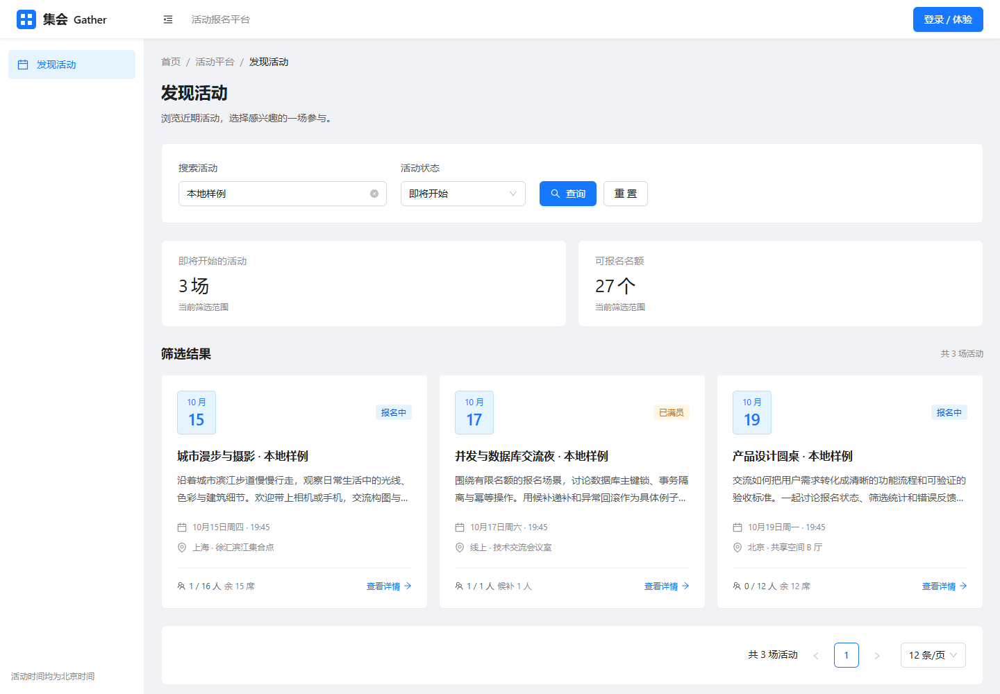

# 集会 Gather · 活动报名平台

[](https://github.com/GTASDAW/MYCODE/actions/workflows/ci.yml)

一个使用 **React + TypeScript 与 Java / Spring Boot** 的活动报名平台，覆盖管理员发布活动、用户报名与候补、站内通知、到场签到、名单导出和管理员操作追溯。界面参考 Ant Design Pro，页面数据来自真实 Java 接口与 MySQL；当前仅在本地运行和演示。

快速了解：[真实界面展示](docs/showcase.md) · [项目讲解与简历素材](docs/interview-kit.md) · [五分钟业务演示](docs/demo-guide.md) · [架构与请求流程](docs/architecture.md)

## 三个技术亮点

| 问题 | 实现方式 | 可以核对的证据 |
| --- | --- | --- |
| 多人同时报名，如何保持名额和候补正确？ | 在 `READ_COMMITTED` 事务中先锁活动主键，再更新报名与人数；有效报名取消时按 FIFO 递补，通知与状态一起提交 | [并发设计与真实 MySQL 回归](docs/concurrency-review.md)、[通知事务](docs/notification-guide.md) |
| 两个 Java 实例，如何共享登录且保留 CSRF 防护？ | 默认使用内存 Session；显式启用 Redis profile 后，由 Spring Session 共享会话，业务一致性仍由 MySQL 保证 | [真实双实例登录、退出、重启及闲置失效验证](docs/shared-session.md) |
| “我的报名”如何分页，且不逐条查询活动？ | 聚合与当前页联表查询共用只读快照；旧数组一次数据 SELECT，新分页两次，统计覆盖本人全部记录 | [SQL、执行计划与查询次数证据](docs/my-registrations-guide.md) |

真实 MySQL、桌面和手机浏览器、默认容器与 Redis 双实例的实际结果见[验证记录](docs/verification.md)，其中注明了测试环境和结论范围。

## 界面预览



上图来自本地真实浏览器与 MySQL 样例数据。更多[个人报名、管理员签到与手机截图](docs/showcase.md)附有截图版本、数据来源和展示说明；静态截图中的日期与人数不代表当前数据库。

## 技术栈

React + TypeScript + Vite + Ant Design + React Router；Java 21 + Spring Boot 4.1.1 + Spring Security；MyBatis Spring Boot Starter 4.0.0（这是 Starter 的版本，不是 MyBatis 核心版本）；MySQL 8.4、Flyway、Maven Wrapper、Docker Compose。可选的 `redis` profile 使用 Spring Session Redis 提供共享登录。

## 本地启动（Windows）

本项目提供不修改系统 PATH、不注册系统服务的本地运行脚本。首次准备会把 JDK 21 和 MySQL 8.4 下载到忽略目录 `.tools`；数据库文件和日志保存在 `.runtime`。需要可用的 Node.js 24 和网络连接。

```powershell
powershell -ExecutionPolicy Bypass -File .\scripts\setup-local.ps1
powershell -ExecutionPolicy Bypass -File .\scripts\start-dev.ps1
```

打开 [http://127.0.0.1:5173](http://127.0.0.1:5173)。前端开发服务器把 `/api` 代理到 Java 服务的 8080 端口；本地 MySQL 使用 3307 端口，只监听回环地址。

停止本项目启动的进程：

```powershell
powershell -ExecutionPolicy Bypass -File .\scripts\stop-dev.ps1
```

脚本不会删除数据库。启动时 Flyway 补齐尚未执行的增量迁移：V4 增加通知表，V5 增加报名签到时间和操作人，V6 增加管理员操作记录，V7 增加用户凭据版本，V8 增加活动分类，V9 增加本人收藏表；不补造历史事件或重置已有数据。缺少版本的旧登录需要重新登录。默认模式的后端 Session 保存在内存中，重启 Java 服务后需要重新登录；这组本机脚本不需要 Redis，数据库中的通知、首次已读时间、签到与操作记录仍保留。

## 演示账号

| 身份 | 用户名 | 初始密码 |
| --- | --- | --- |
| 管理员 | `admin` | `Admin123!` |
| 普通用户 | `demo` | `Demo123!` |

管理员可以使用概览、活动管理、发布活动、报名名单、操作记录和运行指标页面；普通用户能够报名、进入候补、取消和查看个人报名记录。前端参考 Ant Design Pro 的蓝白侧栏布局，手机通过抽屉导航访问页面。首次启动写入演示用户和未来活动，重启时保留已有数据。

活动开始前，管理员可在详情或管理列表编辑标题、介绍、地点和分类，或填写原因取消整场活动；开始时间与名额固定。活动取消后关闭报名、人数归零，有效报名和候补保留为取消历史，用户能查看首次取消原因与时间。操作、并发设计和学习路径见 [活动编辑与取消](docs/activity-lifecycle.md)。

发现页支持标题或地点搜索、六种状态筛选和真实后端分页，默认每页 12 条。搜索条件保存在 URL，刷新、登录后回详情和返回列表仍保留；统计覆盖整个筛选集合，报名后返回会重新读取。接口、统计快照与代码阅读路径见 [活动搜索、筛选与分页](docs/activity-discovery.md)。

活动另有技术交流、运动户外、文化艺术、其他及未分类五种固定单选分类。发布默认未分类，管理员可在允许编辑时修改；活动卡片、详情和管理列表显示分类，个人报名内嵌活动响应也包含分类，操作记录展示真实前后值。公开与管理列表可叠加分类、关键词和状态查询，管理列表也保存 URL 条件、刷新与历史；旧客户端省略分类仍兼容，旧活动不推断分类。接口、迁移和阅读路径见 [活动分类指南](docs/activity-category-guide.md)。

“我的报名”支持全部、已报名、候补、已取消筛选，默认每页 10 条，提供 10、20、50 条选项与手动刷新。四项统计覆盖本人全部记录，已签到是有效报名的子集；页面只展示本人的签到时间，不提供自助签到或签到管理员资料。URL、详情与登录返回保留条件，返回后重新查询并校正越界页。新分页使用两次数据 SELECT，旧数组接口保留字段和排序并改为一次联表读取，消除逐条加载活动；快照、查询证据和学习路径见 [我的报名指南](docs/my-registrations-guide.md)。

详情页支持收藏与取消收藏，匿名用户可登录后回原详情。“我的收藏”显示当前活动资料、分类、状态和北京时间收藏时间，支持分页、刷新、详情返回与末页修正。已开始、已取消活动仍可收藏；收藏只属于本人，不占名额，不触发报名、通知或审计。重复收藏保留首次时间，取消后再收藏使用新时间。

详情页“下载日历”可将未取消活动导出为单场 `.ics`，匿名、已登录及已开始活动均可使用。点击时重新查询最新公开资料，不覆盖页面报名状态；文件只记录开始时间，未提供结束时间或提醒，导入不代表报名成功。文件为下载时快照，活动后续修改或取消不会自动同步；仅验证标准格式与浏览器下载，未声称具体日历客户端导入兼容。此功能不新增业务 API、迁移或依赖。

登录后的顶栏铃铛与“通知中心”提供候补递补和活动取消消息，支持状态筛选、分页、手动刷新和单条标记已读。未读数来自本人全部通知，通知保存当时标题与公开取消原因；重复操作不重复生成，真正再次递补会产生新消息。没有定时轮询或外部消息发送，完整事务、权限与代码路径见 [站内通知指南](docs/notification-guide.md)。

管理员在活动报名名单中查看整场有效报名、已签到和未签到人数，按报名与签到状态共同筛选。活动开始后可手工确认有效报名者到场，首次时间和操作人保留，不提供撤销或自动截止。导出 CSV 包含全部符合条件的记录，最多 20,000 条，采用 UTF-8 BOM、北京时间与面向 Excel 查看用途的文本保护；空集合仅有表头。合同、事务、下载安全与演示见 [签到与 CSV 导出指南](docs/checkin-export-guide.md)。

也可以从登录页进入“注册账号”，创建自己的普通用户。注册成功后需要登录；账号菜单中的“个人中心”可以修改昵称，登录名保持固定。昵称修改后当前页面同步更新，其他独立会话在下一次读取当前用户时取得最新资料。个人中心另有修改本人密码卡片，成功后需重新登录，其他旧会话在下次请求失效；未知提交结果提供手动重新登录确认。接口、安全规则和阅读路径见 [用户注册与个人中心](docs/account-guide.md) 与 [修改密码及会话失效](docs/password-change-guide.md)。

后台“操作记录”按活动 ID 与操作类型筛选，支持分页、刷新、URL 条件与详情抽屉。成功创建、实际编辑、首次取消和首次签到与业务一起提交；详情完整展示字段前后值，活动标题与人员名称保留操作时快照。重复取消、重复签到或无变化编辑不新增，每次创建新活动各记一条；历史事件不补造，也没有修改或删除记录接口。事务、白名单和精确清理见 [管理员操作记录](docs/audit-log-guide.md)。

管理概览的“活动签到分析”按北京时间开始日期筛选已开始、未取消的活动，展示全量有效报名、已签到、未签到与加权签到比例，并逐场比较和进入名单。筛选分页保存在 URL，没有有效报名时比例不适用；支持补录的当前进度不代表最终出勤结算。口径、查询快照和演示路径见 [活动签到分析](docs/attendance-guide.md)。

前端按路由加载页面：发现页直接打开，其他页面在访问时加载，受保护页面先校验权限再加载。慢加载和失败只影响内容区域，导航与登录状态保持；失败可手动重新加载当前地址或返回活动列表。静态资源缓存、真实浏览器恢复和优化前后证据见 [前端加载与恢复](docs/frontend-loading-guide.md)。

## Docker Compose 部署

安装并启动 Docker 后，在项目根目录运行：

```powershell
Copy-Item .env.example .env
docker compose up --build -d
```

打开 [http://localhost:8088](http://localhost:8088)。Nginx 提供前端并转发 `/api`，Java 和 MySQL 只在容器网络内通信；MySQL 数据放在命名卷中。

公网部署前设置 `.env` 中的数据库和演示账号密码，并配置 HTTPS；通过 HTTPS 访问时设置 `SESSION_COOKIE_SECURE=true`。账号密码环境变量只用于首次创建用户，不会在重启时覆盖已经保存的密码。

```powershell
docker compose logs -f backend
docker compose down
```

`docker compose down` 保留数据卷。项目尚未配置云账号或公网域名，当前演示地址为本机地址。

## 可选：Redis 共享登录演示

基础 Compose 仍是单个 Java 实例和内存 Session。需要演示两个后端共享登录时，使用附加配置：

```powershell
docker compose -f compose.yaml -f compose.redis.yaml up --build -d
```

同样访问 [http://127.0.0.1:8088](http://127.0.0.1:8088)。Nginx 轮询两个后端，Session 身份和 CSRF 存入共享 Redis；会话未过期且 Redis 可用时，重启一个后端仍能继续登录。默认闲置时限为 30 分钟，退出会使共享会话失效。

Redis 模式共享会话和登录/注册/改密限流计数，报名、候补、人数与通知继续由 MySQL 事务保证。Redis 密码样例、模式切换、停止命令和验证边界见 [共享 Session 指南](docs/shared-session.md)。网站仍只作本机演示。

登录和注册采用固定窗口限流：默认每个来源最多 60 次登录/60 秒，每个来源与规范提交账号最多 10 次登录/60 秒，注册最多 5 次/600 秒。通过 CSRF 的成功与失败尝试都计数，超限返回 429 与等待秒数；页面保留输入、等待结束后手动重试。默认内存计数，显式 Redis 模式原子共享；代理信任默认关闭，容量与异常有明确处理。配置、取舍与阅读路径见 [登录与注册限流](docs/auth-rate-limit.md)。

## 接口与业务规则

| 接口 | 用途 | 权限 |
| --- | --- | --- |
| `GET /api/auth/csrf` | 获取 CSRF Token | 公开 |
| `POST /api/auth/login` | 表单格式登录 | 公开，但需要 CSRF |
| `POST /api/auth/register` | 创建普通用户，201 返回资料，不自动登录 | 公开，但需要 CSRF |
| `POST /api/auth/logout` | 退出 | 需要 CSRF |
| `GET /api/auth/me` | 从数据库读取当前用户最新资料 | 登录 |
| `PATCH /api/me/profile` | 修改当前用户昵称 | 登录且需要 CSRF |
| `POST /api/me/password` | 验证原密码后修改本人密码，撤销旧登录 | 登录且需要 CSRF、改密尝试限流 |
| `GET /api/activities`、`GET /api/activities/{id}` | 保留原数组列表、详情 | 公开 |
| `GET /api/activities/search` | 搜索、状态筛选、分页与全筛选范围统计 | 公开，个人报名状态只属于当前登录身份 |
| `GET /api/admin/overview` | 活动与报名概览 | 管理员 |
| `GET /api/admin/attendance` | 按北京时间活动开始日期查看当前签到分析，全量统计与分页对比 | 管理员 |
| `GET /api/admin/monitoring` | 当前实例的请求、耗时和连接池快照 | 管理员 |
| `GET /api/admin/audit-logs` | 操作类型、活动 ID 筛选与分页，不返回长文本变更 | 管理员 |
| `GET /api/admin/audit-logs/{id}` | 操作时快照与完整字段变更，缺失返回 404 | 管理员 |
| `GET /api/admin/activities` | 搜索、状态筛选、分页管理列表 | 管理员 |
| `GET /api/admin/activities/{id}/registrations` | 分页、按报名与签到状态查看名单及整场签到统计 | 管理员 |
| `POST /api/admin/activities/{id}/registrations/{registrationId}/check-in` | 确认已开始活动的有效报名者签到，保留首次记录 | 管理员且需要 CSRF |
| `GET /api/admin/activities/{id}/registrations/export` | 导出全部符合两类筛选的 CSV，超 20,000 条返回 413 | 管理员 |
| `POST /api/admin/activities` | 创建活动 | 管理员 |
| `PATCH /api/admin/activities/{id}` | 修改未开始活动的标题、介绍、地点和分类 | 管理员 |
| `POST /api/admin/activities/{id}/cancel` | 取消整场活动并保存原因和历史 | 管理员 |
| `POST /api/activities/{id}/registration` | 报名、重新报名或进入候补 | 登录 |
| `DELETE /api/activities/{id}/registration` | 取消报名或退出候补 | 登录 |
| `GET /api/me/registrations` | 保留原报名数组、字段和排序 | 登录，普通用户与管理员均仅查询本人 |
| `GET /api/me/registrations/search` | 本人状态筛选、分页、全量统计与只读签到时间 | 登录，身份只取可信 Session |
| `GET /api/me/favorites` | 本人收藏分页，默认 10 条、最多 100 条 | 登录 |
| `GET /api/me/favorites/{activityId}` | 本人收藏状态与首次时间，不存在活动 404 | 登录 |
| `POST /api/me/favorites/{activityId}` | 收藏活动，重复保留首次时间 | 登录，需 CSRF |
| `DELETE /api/me/favorites/{activityId}` | 取消本人收藏，重复成功 | 登录，需 CSRF |
| `GET /api/me/notifications` | 本人通知，状态筛选、分页与全量未读数 | 登录 |
| `GET /api/me/notifications/unread-count` | 本人全量未读数量 | 登录 |
| `POST /api/me/notifications/{id}/read` | 单条标记已读，保留首次时间 | 登录且需要 CSRF，只能操作本人通知 |
| `GET /api/health` | 服务和数据库健康状态 | 公开 |

写操作发送 CSRF 接口返回的请求头；登录和退出后重新获取 Token。角色从服务端登录身份读取，不接受客户端指定用户或角色。

V7 在用户行增加凭据版本。每个已登录业务 API 请求在授权前增加一次轻量版本查询，不缓存校验；旧会话访问受保护接口返回 401，公开活动接口清除身份后按匿名读取。个人旧数组的一次、分页的两次业务 SELECT 不包含这次认证读取。改密默认同账号 5 次/600 秒、同来源 20 次/600 秒，成功和失败都计数，默认内存、Redis 模式共享；原登录/注册规则保持。

- 同一活动和用户只有一条报名记录，取消后重新报名会复用这条记录。状态为 `ACTIVE`（有效报名）、`WAITING`（候补中）或 `CANCELLED`（已取消）。
- 名额已满时，报名接口仍返回 200，并把当前用户记录置为 `WAITING`；重复进入候补幂等。取消有效报名后，在同一事务中按排队时间最早的一条候补记录递补为 `ACTIVE`；取消候补只退出队列，不触发递补。
- 活动详情和列表返回 `waitingCount`；概览返回 `waitingRegistrations`；管理报名名单支持 `ALL`、`ACTIVE`、`WAITING`、`CANCELLED` 状态筛选。
- 名额和开始时间创建后固定；活动开始后停止报名、用户取消、编辑和首次活动取消。
- 组织者取消活动时，在同一事务中取消全部有效报名与候补、人数归零，保留所有报名 ID；此前已取消的报名历史不变。重复取消保留首次原因、时间与操作人，即使越过原开始时间仍幂等。已取消活动不可恢复，编辑、报名与用户取消返回 `ACTIVITY_CANCELLED`。
- 报名和取消先锁活动记录，再读取报名状态，最后在同一个事务中修改状态和人数。
- 重复报名、重复取消在活动开放期间返回当前结果，不会重复改变人数。
- 实际候补递补生成一条本人通知；整场取消只通知当时有效报名者与候补者，和业务变更在同一事务内提交或回滚。再次真正递补产生新事件，重复请求不增加消息；标记已读保留首次时间。
- 签到在独立 `READ_COMMITTED` 事务中先锁同一活动，再核对报名归属、活动与有效状态；只保存首次签到时间和可信管理员 ID，不改变人数、报名更新时间、候补排序或通知。名单与导出使用只读快照；未签到筛选仅包含 `ACTIVE`，候补和已取消记录显示“不适用”。
- 四类管理员操作通过业务事务追加审计，失败一同回滚；身份来自可信 Session，名称从数据库读取并保存快照。编辑在原活动锁后精确比较规范化 Java 字符串，无变化不更新；报名热路径仍用原精简锁定投影。
- 个人报名分页的 `total` 按状态筛选，四项 `summary` 统计本人全部历史；列表、总数和统计共用只读 `REPEATABLE_READ` 快照与一次 UTC 微秒时刻。每项的报名 ID 与内嵌活动 ID 不同，本人签到时间来自 V5，查询不改变业务写流程。
- 时间在接口中使用 UTC，在页面中按北京时间显示。

管理活动列表支持标题或地点的字面子串搜索，以及全部、未开始、可报名、满员、已开始、已取消筛选；报名名单支持全部、已报名、候补中、已取消，并可叠加已签到或未签到条件。管理分页默认每页 10 条，接口最多每页 100 条。概览总活动含取消活动，并单独统计 `cancelledActivities`；其他活动时间状态和剩余名额排除取消活动，有效报名与候补仍按报名表状态统计。名单签到统计只包含整场活动的有效报名者，不受筛选和页码影响，详细口径见 [架构与接口说明](docs/architecture.md)。

## 请求追踪与运行指标

进入 Java 的 API 请求返回服务端生成的 `X-Request-Id`，用来关联安全 JSON 日志；5xx 页面提示显示可复制的问题编号。管理员在 `/admin/monitoring` 手动读取当前实例的请求总数、累计平均耗时、5xx 错误率、4xx 数量、按路由统计及数据库连接池快照。

统计只属于当前 Java 进程，重启后重置。路由 P95/最大值是近 5 分钟旋转窗口，健康和监控读取不计入 HTTP Timer；活动记录获取耗时包含 SQL 与行锁等待，不是数据库纯锁等待。范围和排查方式见 [请求追踪与指标说明](docs/observability.md)。

## 验证

先启动本地服务和数据库，再运行：

```powershell
powershell -ExecutionPolicy Bypass -File .\scripts\test-backend.ps1
npm ci
npx playwright install chromium
$env:E2E_DB_HOST = '127.0.0.1'
$env:E2E_DB_PORT = '3307'
$env:E2E_DB_NAME = 'activity_platform'
$env:E2E_DB_USERNAME = 'activity'
$env:E2E_DB_PASSWORD = 'activity_dev_password'
npm run test:e2e
```

后端测试使用独立的 `activity_platform_test` 数据库和真实 MySQL，覆盖事务、权限、CSRF、重复操作、关闭活动，以及 100 个不同用户竞争 10 个名额和跨活动首次报名。公开与管理查询验证统计、字面搜索、状态与分页；公开查询另验证同一次时钟、真实并发取消中的统计/页面快照和可信个人状态。账户测试验证密码哈希、并发重名、可信身份与独立会话的最新昵称。活动生命周期测试控制报名、用户取消、编辑与组织者取消的两种行锁顺序，并检查开始边界、历史、数据库约束和中途异常回滚。通知测试验证准确收件人、快照、重复与再次事件、插入前后失败回滚、并发首次标读和本人读取权限。浏览器测试覆盖实际页面与前后端连接，包含桌面和手机视口。

如果已经安装 Chrome，可以用系统浏览器运行测试，无须下载 Chromium：

```powershell
$env:PLAYWRIGHT_CHANNEL = 'chrome'
npm run test:e2e
```

浏览器测试只在回环地址的开发/测试库创建临时活动和账户，认证失效、迟到响应和候补递补回归也使用这些记录，不修改已有样例活动的报名或预置账号昵称。五个 `E2E_DB_*` 参数必须显式提供，上述值是本机默认样例；如果更换数据库配置，需同步填写。测试结束时，无论断言成功或失败，都核对本次 manifest 的数据库、活动和账户归属，验证全部身份及引用后，在事务内精确清理；清理失败会使检查失败。

manifest 保存在忽略目录 `.runtime/e2e`，不包含凭据。需要重试时，使用同一组数据库环境变量执行 `npm run cleanup:e2e -- .runtime/e2e/<run-uuid>.json`。前端 CSRF 回归测试在 `frontend` 目录运行 `npm test`；清理边界回归在根目录运行 `npm run test:cleanup`。实际执行结果见 [验证记录](docs/verification.md)。

前端生产构建：

```powershell
Set-Location frontend
npm ci
npm run build
```

## 自动检查与交付

GitHub Actions 在推送 `main`、Pull Request 和手工触发时运行前端测试与构建、Java 21 + 真实 MySQL 集成测试、默认 Compose 环境的迁移与重启检查，以及 Redis 双实例共享登录和桌面/手机浏览器检查。两种 Session 模式分别验证，构建和检查不会发布网站。

独立的 `performance` 任务在 `gather-perf-ci`、`activity_platform_perf` 和固定容器资源下执行两种报名场景，共 18 轮正式测量；当前 v2 脚本先执行 20 次读取和 400 次真实写预热，预热单独验证及清理。它记录客户端原始延迟、吞吐量、错误及真实数据库一致性；[性能评测](docs/performance-report.md) 保留首次 v1 历史结果，当前方法见 [查询优化复盘](docs/query-optimization-review.md)。

单独的 `.github/workflows/query-comparison.yml` 通过 `workflow_dispatch` 手工触发，按 A1 → B1 → B2 → A2 在同一隔离主机对照旧、新锁定查询，共 72 批、7200 次正式报名，1600 次写预热另记并清理。常规 `ci.yml` 保持原有五个检查，不在每次推送时重复固定旧版本实验。改动只收窄内部锁定投影，保留活动行锁、事务、候补 FIFO 和真实详情查询；假设、测量边界与本轮结论见 [锁定查询优化复盘](docs/query-optimization-review.md)。

这份历史对照固定 V2 和三列锁定投影，复现应检出 `d781648d7d9036b653a80e3082b609358a59df35`；V3 为取消判断增加第四列，V4 增加通知表与业务事务中的通知写入，V5 增加签到字段，V6 增加管理员操作表，V7 增加凭据版本和认证读取，V8 增加分类读取与筛选。脚本发现迁移、活动 Mapper 或报名事务不同会拒绝沿用旧实验。常规性能任务则在当前 V9 上运行单版 18 批，不把新业务结果写成历史 SQL 优化收益。

查看 [Actions 运行结果](https://github.com/GTASDAW/MYCODE/actions)，失败诊断包含日志、后端报告、浏览器截图与 trace。容器浏览器与 Redis 任务各自使用独立的 `activity_platform_e2e`；性能任务使用 `activity_platform_perf`，均不使用本机演示库。具体环境、复现命令和清理机制见 [交付指南](docs/delivery-guide.md)。本次实际执行结论见 [验证记录](docs/verification.md)。

## 从代码中学习

1. 从 `frontend/src/api.ts` 看页面如何发送 HTTP 请求。
2. 从 `backend/src/main/java/com/example/gather` 的 Controller、Service、Mapper 跟踪请求。
3. 从 `backend/src/main/resources/db/migration` 看六张业务表、唯一约束、V2 候补状态、V3 活动取消元数据、V4 通知历史、V5 签到字段、V6 管理员操作记录、V7 用户凭据版本、V8 活动分类及 V9 收藏表的增量迁移。
4. 用一个报名请求串起 React → HTTP → Spring Security → Service → SQL → MySQL → 页面刷新。

- [四阶段学习指南](docs/learning-guide.md)
- [架构与接口说明](docs/architecture.md)
- [用户注册与个人中心](docs/account-guide.md)
- [活动编辑、取消与历史记录](docs/activity-lifecycle.md)
- [活动搜索、筛选、分页与 URL 状态](docs/activity-discovery.md)
- [我的报名、本人签到与联表查询](docs/my-registrations-guide.md)
- [站内通知、事务事件与首次已读时间](docs/notification-guide.md)
- [管理员签到、整场统计与 CSV 导出](docs/checkin-export-guide.md)
- [管理员操作记录、字段快照与事务追溯](docs/audit-log-guide.md)
- [活动签到分析、加权比例与日期快照](docs/attendance-guide.md)
- [前端按需加载、静态资源缓存与失败恢复](docs/frontend-loading-guide.md)
- [并发报名复盘](docs/concurrency-review.md)
- [五分钟演示与面试讲解](docs/demo-guide.md)
- [真实桌面与手机界面展示](docs/showcase.md)
- [项目讲解、简历素材与掌握自检](docs/interview-kit.md)
- [自动检查与可复现交付](docs/delivery-guide.md)
- [Redis 共享 Session 与双实例演示](docs/shared-session.md)
- [登录与注册限流、可信来源与共享计数](docs/auth-rate-limit.md)
- [请求追踪与运行指标](docs/observability.md)
- [可复现报名性能评测](docs/performance-report.md)
- [报名锁定查询优化与版本对照](docs/query-optimization-review.md)
- [验证记录与当前部署边界](docs/verification.md)

当前实现重点是完整业务流程、数据库一致性和可以复现的验证结果。Redis 可选方案用于共享 Session 与认证入口限流，默认本机启动保持简单；名额缓存、报名接口限流和 Redis 高可用尚未实现。
