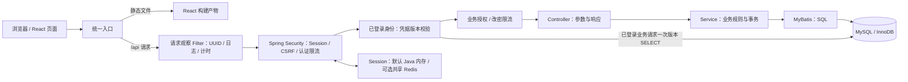
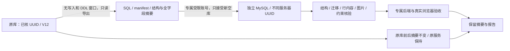

# 活动报名平台：架构与请求流程

这个项目展示一个完整的全栈流程：管理员发布、编辑或取消活动，用户查看名额、报名或进入候补，活动开始后管理员确认到场并导出名单。系统在并发请求下维护正确人数、递补队列、取消历史、站内通知、首次签到和管理员操作记录。

## 技术分工

| 层次 | 技术 | 负责的事情 |
| --- | --- | --- |
| 页面 | React、TypeScript、Vite、Ant Design、React Router | 页面路由、表单、加载状态、错误反馈 |
| HTTP 接口 | Java 21、Spring Boot 4.1.1 | 接收请求、参数校验、返回 JSON、名单 CSV 或封面 JPEG |
| 请求追踪与指标 | 请求观察 Filter、MDC、结构化日志、Micrometer Timer | 关联请求与安全错误日志，记录当前实例耗时与连接池快照 |
| 身份与权限 | Spring Security、Cookie Session、CSRF | 注册、登录、凭据版本校验、管理员权限与改密后的旧身份失效 |
| 会话存储 | 默认 Java 内存；可选 Spring Session Redis | 默认单实例或两个实例共享同一登录与 CSRF |
| 业务与事务 | Java 服务层、Spring 事务 | 报名规则、取消规则、事务边界 |
| 数据访问 | MyBatis Spring Boot Starter 4.0.0 | 执行明确的 SQL，包括行锁查询 |
| 数据存储 | MySQL 8.4、InnoDB | 用户、活动（含封面）、报名、通知、审计、收藏六表及约束 |
| 运行环境 | Maven Wrapper、npm、Docker Compose、Nginx | 构建、启动、同源部署 |

开发时，统一入口是 Vite：页面发出相对路径的 `/api` 请求，由 Vite 代理到 Java 服务。部署时，统一入口是 Nginx：它提供前端静态文件，并把 `/api` 请求转发给后端。两种方式都让浏览器通过同一个来源访问页面和接口。

上图把匿名请求也画在同一路径上：匿名请求跳过版本查询；旧版本身份访问公开活动时清除身份后匿名读取，访问受保护接口返回 401，版本查询故障返回 503。版本读取发生在业务授权和业务事务前，与后文的列表快照分开计算。

发现页直接加载，其他业务页面通过模块级懒加载按路由进入。Router、Layout、认证及通知 Provider 保持原实例，权限门禁在懒页面外；只有内容区域进入加载或错误状态。手动恢复执行真实当前地址刷新，不用重挂同一懒组件假装重试；正常 query/hash 改变不重挂页面。构建默认拆包、HTML 重新验证与带 hash 资源缓存、缺失资源真实 404 的合同及证据见 [前端加载指南](frontend-loading-guide.md)。

## 六张业务表

- **用户**：保存唯一登录名、密码哈希、展示名、角色和 V7 凭据版本。自主注册只创建普通用户；服务端从登录身份取得用户 ID，报名、昵称与密码修改请求不能自行指定操作人。
- **收藏**：V9 `activity_favorites` 保存本人和活动的唯一组合及 UTC 微秒时间，外键保护关联，按本人收藏时间/ID 倒序分页。重复插入保留首次信息，取消物理删除本人的收藏，不删除活动历史。收藏不加入活动报名锁或审计流程。
- **活动**：保存标题、介绍、地点、开始时间、可空结束时间、总名额和当前有效报名人数，V8 增加固定单选分类，旧活动为未分类。V10 在同一活动行保存成对的封面 JPEG 与 hash，列表只读 hash，报名热锁不读图片。候补人数由报名记录按活动实时统计。开始、结束时间与名额创建后固定；V3 增加取消时间、原因和可信操作人，取消后人数为 0。
- **报名记录**：关联用户与活动，记录有效报名、候补中或已取消状态。`(activity_id, user_id)` 设置唯一约束；取消后保留记录，重新报名时更新同一条记录。V5 增加成对的可空签到时间、操作人；非空时必须为 `ACTIVE`，操作人关联用户且外键限制删除。
- **站内通知**：V4 保存收件人、活动、事件类型、当时标题、公开取消原因、UTC 创建与首次已读时间。只在实际递补或首次活动取消时写入，同业务事务提交；外键保留历史，真正再次递补可产生新记录。
- **管理员操作记录**：V6 保存发布、真实编辑、首次取消和首次签到的动作、活动与名称快照、可信操作人、可空签到目标、UTC 微秒时间和完整字段变化。与业务同事务追加，不回填旧历史；活动、操作人、报名分别为限制删除的独立外键，签到同活动归属由业务查询检查。

需要始终满足：活动的当前人数等于该活动的 `ACTIVE` 报名记录数，并且在 `0` 到总名额之间；`WAITING` 记录不占用名额。唯一约束保证同一个用户不会有两条报名记录；事务和行锁保证并发操作下人数正确，候补记录按排队顺序递补。

## HTTP 接口与访问权限

| 方法与路径 | 行为 | 权限 |
| --- | --- | --- |
| `GET /api/auth/csrf` | 获取后续写请求需要的 CSRF 信息 | 可匿名调用 |
| `POST /api/auth/register` | 创建普通用户，201 返回资料，不自动登录 | 可匿名调用，需 CSRF |
| `GET /api/auth/me` | 按可信身份从数据库读取最新用户资料 | 已登录用户 |
| `PATCH /api/me/profile` | 只修改当前用户昵称 | 已登录用户，需 CSRF |
| `POST /api/me/password` | 验证数据库原哈希，原子改密和递增版本，成功后退出 | 已登录用户，需 CSRF 和改密限流 |
| `GET /api/activities` | 查看活动列表 | 可匿名调用 |
| `GET /api/activities/search` | 搜索、状态筛选、分页与匹配集合统计 | 可匿名调用，个人状态来自可信当前身份 |
| `GET /api/activities/{id}` | 查看活动详情 | 可匿名调用 |
| `GET /api/activities/{id}/cover` | 读取公开 JPEG 封面，需重新验证缓存 | 可匿名调用 |
| `GET /api/admin/overview` | 管理概览的八项真实统计（含候补和取消活动数） | 管理员 |
| `GET /api/admin/attendance` | 按北京时间开始日期筛选的当前签到分析，全量统计与逐场分页 | 管理员 |
| `GET /api/admin/monitoring` | 当前 Java 实例的请求、耗时和连接池快照 | 管理员 |
| `GET /api/admin/audit-logs` | 动作/活动筛选分页，只返回记录元数据 | 管理员 |
| `GET /api/admin/audit-logs/{id}` | 操作快照与完整字段前后值 | 管理员 |
| `GET /api/admin/activities` | 搜索、筛选并分页查看活动 | 管理员 |
| `GET /api/admin/activities/{id}/registrations` | 两类状态筛选分页与整场签到统计 | 管理员 |
| `POST /api/admin/activities/{id}/registrations/{registrationId}/check-in` | 活动开始后为有效报名者保存首次签到 | 管理员，需 CSRF |
| `GET /api/admin/activities/{id}/registrations/export` | 全筛选范围 CSV，最多 20,000 条 | 管理员 |
| `POST /api/admin/activities` | 创建活动 | 管理员 |
| `PATCH /api/admin/activities/{id}` | 修改未开始活动的标题、介绍、地点和分类 | 管理员，需 CSRF |
| `POST /api/admin/activities/{id}/cover` | 校验并重编码上传封面，与真实变更审计同事务 | 管理员，需 CSRF，活动未开始且未取消 |
| `DELETE /api/admin/activities/{id}/cover` | 移除封面，重复移除不新增审计 | 管理员，需 CSRF，活动未开始且未取消 |
| `POST /api/admin/activities/{id}/cancel` | 取消活动，保存首次原因、时间和报名历史 | 管理员，需 CSRF |
| `POST /api/activities/{id}/registration` | 报名、重新报名或进入候补；满员时返回 `WAITING` 状态 | 已登录用户 |
| `DELETE /api/activities/{id}/registration` | 取消有效报名或退出候补 | 已登录用户 |
| `GET /api/me/registrations` | 原完整数组，保留字段与更新时间/ID 降序 | 已登录用户，仅本人 |
| `GET /api/me/registrations/search` | 本人筛选分页、全量统计与只读签到时间 | 已登录用户，普通用户与管理员均仅本人 |
| `GET /api/me/notifications` | 本人状态筛选分页与全量未读数 | 已登录用户 |
| `GET /api/me/notifications/unread-count` | 本人全部未读数 | 已登录用户 |
| `POST /api/me/notifications/{id}/read` | 标记本人通知已读，保留首次时间 | 已登录用户，需 CSRF |

登录、退出和获取当前用户的接口由认证模块提供。前端根据身份显示入口，最终授权仍由后端执行：隐藏按钮不能阻止别人直接调用接口。

注册经 `AuthController → AccountService → UserMapper`：规范化用户名、校验昵称与密码、使用既有 BCrypt12 哈希、固定 `USER` 角色后插入。`uq_users_username` 决定并发重名的唯一成功者，冲突返回 409 `USERNAME_TAKEN`。昵称修改经 `ProfileController`，只更新登录身份 ID 对应的 `display_name`；详细输入规则见 [账户指南](account-guide.md)。

改密经 `PasswordController → PasswordChangeService → UserMapper`，读取数据库原哈希与版本，用可信 ID 和旧版本条件一次更新新哈希及版本。BCrypt 不持有行锁，事务提交后清除当前认证和 CSRF、保留匿名 HTTP Session。`CredentialVersionFilter` 在业务授权前额外执行一次版本 SELECT，不缓存、不读哈希；旧版本受保护请求 401，公开活动按匿名继续，数据库失败 503。Redis 不枚举所有 Session，也不删除仍被在途请求使用的 key；迟到保存不能恢复旧版本权限，已通过校验的在途操作允许完成。认证读取与业务快照/SELECT 次数分别统计，完整错误及 Cookie 竞态处理见 [改密指南](password-change-guide.md)。

前端 `/register` 成功后返回登录页，`/profile` 由登录保护后挂载。用户状态仍由 `AuthProvider` 管理，读取/修改资料按账号、认证代次与顺序忽略过期响应，避免旧昵称或旧账号覆盖当前页面。服务端不重写整个 Session `SecurityContext` 来同步昵称，`/auth/me` 直接查数据库最新资料；其他独立会话下一次读取才能更新，没有实时推送或轮询。

## 站内通知

递补在报名状态、人数变化后向实际递补者插入 `PROMOTED`；整场取消在状态批量取消前，向当时 `ACTIVE`/`WAITING` 集合插入 `ACTIVITY_CANCELLED`。两条路径继续持有活动主键行锁，`NotificationService` 写入方法必须加入已有事务；任何步骤失败，通知与业务状态一起回滚。重复状态不插入，新一次真实递补生成新事件。标题与原因保留事件快照，旧消息不跟随后来的编辑变化。

`NotificationController → NotificationService → NotificationMapper` 从可信 Session 取得收件人 ID。列表默认 10 条、最多 100 条，按创建时间与 ID 降序；`ALL/UNREAD/READ` 筛选总数、全量本人未读数和当前页共享只读 `REPEATABLE_READ` 快照。标读只更新本人尚未读行，在 `READ_COMMITTED` 下保留首次 UTC 微秒时间；他人和不存在的通知均返回 404。

前端 `/notifications` 受登录保护，筛选分页保存到 URL。`NotificationProvider` 复用 `AuthProvider` 的身份和认证代次，列表响应同时更新顶栏；非通知页面在登录后读取未读数、离开通知页时再读取，标读后重新加载当前页，没有轮询。未知或失败用 `—` 表示，认证、请求顺序与中止保护避免旧结果覆盖新账号或最新已读状态。接口、V4、事件插入时机和测试阅读路径见 [站内通知指南](notification-guide.md)。

## 公开活动发现

`/activities` 通过 `GET /api/activities/search` 查询分页对象 `{items,total,page,pageSize,summary}`，旧 `/api/activities` 数组接口继续保留。公开分页默认 12 条，最多 100 条；关键词最多 200 个 UTF-16 代码单元，在标题或地点中作字面子串匹配，不裁剪空格。公开和管理查询共用 `ActivityQuerySql.FILTER`，八种状态沿用下表口径。查询身份来自 Session，客户端不能指定其他人的 `registrationStatus`。

V8 为活动响应增加 `category`，公开及管理列表接受默认 `ALL` 的分类过滤，与状态和关键词共同作用于聚合和当前页，维持原快照、时间和排序。创建缺失/null 分类默认未分类，编辑缺失/null 保留现值，分类编辑和真实审计共用原活动锁及事务；个人报名的独立联表同步字段，报名热锁四列保持。固定代码、兼容规则、URL 与执行计划阅读路径见 [分类指南](activity-category-guide.md)。

V9 收藏通过 `/api/me/favorites` 读取本人分页，通过 `/{activityId}` 的 GET/POST/DELETE 查询、收藏和取消；响应状态为 `{favorited,favoritedAt}`，分页为 `{items,total,page,pageSize}`，每项包含活动对象和收藏时间。两次业务 SELECT 共用 REPEATABLE_READ 快照及单次时刻，当前页联表读取本人报名状态和实际候补数，复用 `ActivityView`，不逐条查活动。认证版本 SELECT 另计一次。所有存在活动可收藏，既有公开响应不增加收藏字段；页面 `/my-favorites` 按需加载，详情返回只接受规范内部来源。清理与基线扩展到六表，先核对并删除准确声明的收藏对，再处理原五表。

公开查询在只读 `REPEATABLE_READ` 事务中固定一次 UTC 微秒时间，聚合与分页共享快照；`total` 和 `summary` 覆盖整个筛选集合，统计不由当前页卡片计算。排序为 `starts_at ASC, id ASC`，越界返回真实总数、统计与空 `items`。公开读取不增加活动写锁，也不改变报名的 `READ_COMMITTED` 事务。

前端已提交的筛选与页码来自 URL，输入草稿独立。状态或每页数量改变回第一页，相同条件查询也真正刷新；结果减少时以 `replace` 回合法页。详情 `from` 只接受规范内部列表路径，刷新与登录再返回仍保存条件，返回后重新读取个人状态和统计。完整合同、时间边界及测试路径见 [活动发现指南](activity-discovery.md)。任意字面子串使用绑定参数 `LOCATE`，本轮没有声称 B-tree 索引可直接加速此类匹配或增加未经验证的索引。

## 个人报名读取

`GET /api/me/registrations/search` 默认 `page=1&pageSize=10&status=ALL`，状态为 `ALL|ACTIVE|WAITING|CANCELLED`，每页 1–100 条。返回 `{items,total,page,pageSize,summary}`；行是 `{id,status,activity,checkedInAt}`，`id` 是报名 ID，`activity.id` 是活动 ID。只暴露本人的可空 UTC 签到时间，不包含管理员 ID 或昵称；用户不能自行签到。

筛选只影响 `items` 和 `total`。`summary` 的 `activeRegistrations`、`waitingRegistrations`、`cancelledRegistrations`、`checkedInRegistrations` 覆盖本人全部记录，已签到仅计 `ACTIVE` 中非空签到时间；排序为报名 `updated_at DESC, id DESC`。身份来自可信 Session，传入 `userId` 不改变归属。越界返回请求页码、真实总数/统计和空列表，由页面校正。

`RegistrationService.searchMine` 在只读 `REPEATABLE_READ` 中固定一次 UTC 微秒时刻，第一次聚合合并筛选总数与全量统计，第二次联表读取当前页活动、候补数和本人状态，两次共用数据库快照。旧 `mine` 保留 `{id,status,activity}` 数组和排序，内部改为一次联表查询，不逐条调用 `ActivityService.get`。候补 COUNT 仍是关联子查询；应用数据 SELECT 为旧接口 1 次、新分页 2 次，不代表底层工作量恒定或已有性能收益。

前端状态/页码/每页数量存于 `/my-registrations` URL，默认省略，改变状态或数量回第一页；刷新、历史和详情返回保留条件，越界 `replace` 修正。详情来源按精确内部 `/activities` 或 `/my-registrations` 分派与规范化，保留原公开列表安全合同；个人读取和详情操作使用认证代次、请求中止及页面条件保护，旧 401 不使新会话退出。读取不增加活动写锁，没有轮询、新迁移或新索引。合同与真实执行计划见 [我的报名指南](my-registrations-guide.md)。

## 复制活动与普通发布

复制是管理员发布表单的辅助入口，/admin/activities/new?copyFrom={id} 复用 GET /api/activities/{id} 读取公开来源字段，再由原 POST /api/admin/activities 新建。所有来源状态可用，但入口与页面仍在管理员门禁内；只预填五项基本资料，清空开始、结束和报名截止时间，无封面/人员/状态/历史关联，也不保存来源ID或草稿。复制本身不增加接口、数据库字段或依赖。

CreateActivityPage 保留页面实例，通过按路径/来源/身份隔离的来源读取和表单子区域保护草稿；成功读取才预填一次。提交显式构造 NewActivity，旧提交不能导航或影响新来源/身份；登录返回保留查询参数。具体参数与错误行为见 [活动生命周期](activity-lifecycle.md#管理员复制活动)。

## 报名截止

V12 在活动行增加可空 registration_deadline，CHECK严格早于starts_at；旧值为null，等同开始时截止。创建接口可选registrationDeadline，UTC微秒规范化后要求当前<截止<开始，创建后固定，CREATE审计保存实际值。公开、管理、本人报名及收藏的活动投影统一返回registrationDeadline/registrationClosed；closed仍只表示取消或已开始，取消、编辑、封面和签到权限使用原规则。

RegistrationService只在报名路径于活动主键锁后读取一次UTC微秒当前时刻，按取消、开始、截止顺序拒绝；取消路径不提前截止，既有候补仍能在开始前按FIFO递补与通知。页面由独立activityRegistrationClosed控制报名入口，原activityClosed控制开始前取消/管理；已有边界计时器加入截止时间，无轮询。API、错误码和字段链路见 [报名截止时间](activity-lifecycle.md#报名截止时间)。

## 管理查询与统计口径

管理入口包括概览 `/admin/dashboard`、活动管理 `/admin/activities`、发布活动 `/admin/activities/new`、编辑活动 `/admin/activities/{id}/edit`、报名名单 `/admin/activities/{id}/registrations`、操作记录 `/admin/audit-logs` 和运行指标 `/admin/monitoring`。页面先通过既有认证与管理员权限检查，再挂载管理查询；普通用户访问这些路径不能触发管理数据请求。

`GET /api/admin/activities` 接受 `page`（默认 1）、`pageSize`（默认 10）、`keyword`（默认空）、`status` 和 `category`（均默认 `ALL`），返回 `{items,total,page,pageSize}`。页码至少为 1，每页 1–100 条，关键词最多 200 字。关键词在标题或地点中作字面子串匹配，`%`、`_` 和反斜杠不会成为通配符；SQL 使用绑定参数和 `LOCATE`。结果按开始时间升序、活动 ID 升序排列。管理页面已提交条件来自 URL，草稿单独保存，刷新及历史保留，改变分类或数量回第一页，越界 replace 校正。

| 活动筛选 | 口径 |
| --- | --- |
| `ALL` | 所有活动 |
| `UPCOMING` | 未取消且开始时间晚于当前时间，包含满员活动 |
| `OPEN` | 未取消、尚未开始、未到报名截止且有剩余名额 |
| `FULL` | 未取消、尚未开始、未到报名截止且有效报名人数等于总名额 |
| `STARTED` | 未取消且开始时间等于或早于当前时间；含进行中、已结束和未知结束 |
| `ONGOING` | 未取消且结束非空，开始时间 ≤ 当前时间 < 结束时间 |
| `ENDED` | 未取消且结束非空，结束时间 ≤ 当前时间 |
| `CANCELLED` | 取消时间非空，不依赖原开始时间 |

概览的 `totalActivities` 是所有活动数，包含已取消活动；`cancelledActivities` 单独统计取消活动。`upcomingActivities` 和 `startedActivities` 对应上述排除取消的开始时间条件，提前截止仍计入未开始；`fullActivities` 只统计未取消、尚未开始且未到报名截止的满员活动；`activeRegistrations` 包含所有活动的 `ACTIVE` 报名记录，`waitingRegistrations` 包含所有活动的 `WAITING` 候补记录；`availableSeats` 只汇总未取消、尚未开始且未到报名截止活动的剩余名额。每个请求固定一个 UTC 微秒当前时间，SQL 和返回状态共享这一时间，避免临界时间出现两个口径。

`GET /api/admin/activities/{id}/registrations` 接受同样的分页参数，`status=ALL|ACTIVE|WAITING|CANCELLED` 与 `checkInStatus=ALL|CHECKED_IN|NOT_CHECKED_IN` 默认均为 `ALL`、按 AND 组合，返回 `{activity,items,total,page,pageSize,summary}`。签到筛选只匹配 `ACTIVE`，因此候补或已取消与已签到/未签到组合时为空。名单行保留原字段，增加可空 UTC `checkedInAt`、`checkedInBy` 与管理员当前数据库昵称 `checkedInByDisplayName`；按 `updated_at DESC, id DESC` 排列。不存在的活动返回 404。`activity` 同时返回当前 `waitingCount`。

`summary` 的 `activeRegistrations`、`checkedInRegistrations`、`notCheckedInRegistrations` 统计整场活动全部 `ACTIVE`，不受筛选和分页影响。活动、三项统计、筛选总数与名单共用只读 `REPEATABLE_READ` 快照；签到仅修改两个审计字段，不改变排序使用的报名更新时间。

管理列表的总数和当前页查询在只读 `REPEATABLE_READ` 事务的同一快照内执行；概览用一条 SQL 取得八项统计，并单独统计报名表，避免关联多条报名记录后重复累计活动和名额。这些查询不改变报名业务的 `READ_COMMITTED` 事务与行锁设计。

筛选条件或每页数量改变时，前端回到第一页。活动列表在第一页使用相同关键词再次点击查询，也会重新读取服务端数据；其他位置提交搜索回到第一页。报名变化让当前页超出总页数时，两个管理列表自动回到最后一个有效页，最少为第一页。读取请求在页面或账号切换时取消或忽略过期结果，页码校正也不能覆盖更新后的查询条件。

运行指标返回 `scope=CURRENT_JVM`、实例编号及启动/采样时间，页面仅手动刷新。请求数、平均耗时和错误率是本进程累计值；按路由/状态的 P95 与最大值来自 300 秒 Micrometer 旋转窗口，属于近似统计，不能跨路由或实例平均为全局 P95。健康与监控读取不计入自定义 HTTP Timer；活动记录获取耗时包含 SQL 执行与行锁等待。请求标识、日志边界和详细口径见 [请求追踪与运行指标](observability.md)。

## 一次报名请求怎么走

1. 用户在活动详情页点击报名。前端携带 Session Cookie，以及从认证模块取得的 CSRF 请求头。
2. 请求观察 Filter 先生成 `X-Request-Id`，在 Session 和 Spring Security 处理期间保留 MDC；Spring Security 验证 CSRF 和登录身份。没有登录的请求不会进入报名业务。
3. Controller 接收活动 ID，服务层从可信的登录身份取得用户 ID。
4. 服务层开启 `READ_COMMITTED` 隔离级别的事务，先用 `SELECT ... FOR UPDATE` 锁定活动记录。
5. 取得锁后先检查活动是否取消，再检查是否已经开始，然后用普通 `SELECT` 读取该用户的报名记录并检查名额。
6. 已有效报名或已在候补时直接返回当前结果；有空位时首次报名创建 `ACTIVE` 记录，或把已取消记录恢复为 `ACTIVE`，并增加一次活动人数。满员时首次报名创建 `WAITING` 记录，或把已取消记录重新排到候补队列，不增加活动人数。
7. 事务提交后释放锁，接口返回最新结果，前端刷新活动信息和报名状态。

取消也先锁同一条活动记录，然后处理报名状态和人数。取消 `ACTIVE` 记录时先减一，再按 `updated_at ASC, id ASC` 取一条最早候补记录转为 `ACTIVE` 并加一，随后插入该用户的递补通知；取消 `WAITING` 记录只退出候补，不触发递补。开放期间，重复取消不会重复改变人数或通知；活动开始后，报名和取消都被拒绝。失败时事务回滚，报名状态、人数和本次通知一起恢复。

报名记录查询不额外加 `FOR UPDATE`：所有报名状态变更（包括候补递补）已经被所属活动的行锁保护，`READ_COMMITTED` 下的普通查询能读取等待前一事务提交后的状态。这避免查询空报名键时引入间隙锁，影响其他活动的首次报名。验证既包括单个活动争名额、候补递补，也包括不同活动同时首次报名。

内部 `ActivityMapper.lockById` 映射为 `ActivityLockRow`，只读取开始时间、总名额、当前有效人数和取消时间四个业务字段；公开展示的 `ActivityRow` 仍包含标题、介绍、地点、取消原因及实时候补人数。返回前的 `ActivityService.get` 在同一事务内重新读取完整详情，因此收窄锁定投影不会改变公开响应。锁定阶段移除的候补 COUNT 是同一条 SQL 中的子查询，版本对照和实际收益边界见 [查询优化复盘](query-optimization-review.md)。

## 组织者编辑与取消

编辑与整场取消也在 `READ_COMMITTED` 事务中先锁活动主键行。编辑只改标题、介绍、地点和分类；取消把该活动的 `ACTIVE`/`WAITING` 报名变为 `CANCELLED`，人数置 0，并同时保存首次原因、UTC 微秒时间和管理员 ID。已有取消报名的 ID 与更新时间保留，取消整场活动不递补候补。并发报名、用户取消或编辑无论先后顺序，都受同一活动行锁保护；失败全部回滚。

已取消活动返回 `cancelled=true`、原因、时间及 `closed=true`。有效的重复组织者取消保留首次结果，越过原开始时间仍幂等；报名、用户取消和编辑返回 409 `ACTIVITY_CANCELLED`。未取消活动开始后拒绝首次编辑或组织者取消，检查时间发生在取得锁后。V3 的外键和 CHECK 保证取消元数据完整与人数为 0，跨表状态不变量还依赖事务。详细 API、迁移、页面认证代次保护和真实验证路径见 [活动生命周期](activity-lifecycle.md)。

## 管理员签到与 CSV

`AdminController → CheckInService → ActivityMapper/AdminMapper` 使用独立 `READ_COMMITTED` 写事务。先锁活动主键，普通读取该活动内的报名，再核对取消状态、取得锁后的 UTC 微秒时间与 `ACTIVE` 资格。活动开始时即开放签到，活动结束后仍可补录，不设置自动截止；重复请求保留首次时间和可信管理员 ID。报名表只改 V5 的两个签到字段，并在同事务追加首次 `CHECK_IN` 操作记录；不增减人数、不修改报名状态或更新时间、不递补或写通知，第一版不提供撤销。

名单与导出接受默认空、最多200字符的keyword，按账号或当前昵称的字面包含匹配，与两类状态按AND组合，COUNT与数据行共用SQL条件及只读RR快照；整场签到统计不受搜索影响，排序保持updated_at DESC,id DESC。名单条件存URL、输入草稿独立，刷新/历史/登录和同活动详情返回保留；读取、签到与导出作用域包含已提交关键词，不使用未提交草稿。保持V12，无新字段、索引或依赖。

名单导出复用上述条件与原排序，在只读快照内先计数、再取全部匹配记录；超过 20,000 条返回 413 `EXPORT_TOO_LARGE`，不会截断。响应为 UTF-8 BOM、CRLF、双引号转义的 `text/csv;charset=UTF-8`，文件名 `activity-{id}-registrations.csv`，`Cache-Control: no-store`；空集合仅表头。时间转换为北京时间，自由文本及 ID 在引号内加 Tab，面向 Excel 人工查看而非无损原始数据导入。

前端统一 `api.ts` 增加文件响应分支：非成功响应仍解析 JSON 与请求编号，成功文件仅接受 CSV MIME。页面读取、签到和下载复用认证代次与取消信号，进一步核对当前筛选、页码及刷新版本，旧响应不能下载文件、显示旧提示或使新会话退出；临时链接与对象 URL 最终清理。具体错误、输入边界和阅读路径见 [签到与导出指南](checkin-export-guide.md)。两个新接口使用固定日志/指标路由，名单和文件内容不进入请求日志。

## 管理员操作记录

`ActivityService.create/edit/cancel` 和 `CheckInService.checkIn` 在原写事务调用 `AuditLogService`，追加使用 `MANDATORY`，失败使业务与记录一起回滚。每个新活动一条 `CREATE`；无变化编辑、重复取消和重复签到不追加，旧历史不回填。名称从事务内数据库取得并保存快照，白名单变化为完整 `string|null` 前后值，不保存请求体、密码或 Cookie。发布开始时间先规范为微秒，再验证落库值仍在未来。

两个 GET 只允许 ADMIN。列表只查元数据，总数与分页共用只读 `REPEATABLE_READ` 快照，按操作时间与 ID 降序；详情才读取变化 JSON。页面将筛选分页写入 URL、按需打开只读抽屉，并以认证代次、请求作用域和取消信号保护成功与错误。记录没有更新或删除 API。V6 约束、独立外键边界、精确清理及源码验证路径见 [管理员操作记录指南](audit-log-guide.md)。

## 活动签到分析

管理概览保留原统计与近期活动，新增按北京时间开始日期筛选的当前签到进度。`AttendanceController → AttendanceService → AttendanceMapper` 在一次 UTC 微秒时刻和只读 `REPEATABLE_READ` 快照中执行全量聚合与当前页联表两次业务 SELECT；日期先转换为 UTC 半开区间，再对 `starts_at` 作范围比较，同时排除未开始和已取消活动。

总量与每场的有效报名取真实 `ACTIVE` 记录，签到是其中的非空时间子集。整体比例按总签到除以总有效报名计算，零分母为 `null`，不平均各场百分比；没有有效报名的活动仍纳入活动场次。结束后仍支持管理员补录，未签到不能当作最终缺席，也不从复用的报名记录生成历史每日新增。参数、URL、真实查询证据与阅读路径见 [签到分析指南](attendance-guide.md)。

## 活动封面

发布后通过编辑页的独立封面卡片保存，原 JSON 创建/编辑接口保持兼容。`ActivityCoverImages` 在活动事务之前校验 2 MiB、扩展名、声明及真实格式、宽高与像素，并解码后以白底 RGB 缩放至最长 1600、重编码 JPEG；不保存原文件名或元数据，不执行 SVG，也不接受外部图片 URL。实现参考 [OWASP 上传校验说明](https://cheatsheetseries.owasp.org/cheatsheets/File_Upload_Cheat_Sheet.html)，不将重编码宣称为所有恶意内容检测。

V10 在活动行新增成对的 `cover_image` 与 `cover_hash`；数据量受上限控制，沿用数据库持久化/回滚与双实例共享。列表和个人联表只投影摘要，生成 `/api/activities/{id}/cover?v={hash}`，不读取图片正文或增加逐条查询。匿名图片接口返回 JPEG、`nosniff`、`no-cache` 和 ETag，活动取消或开始后仍可查看既有封面。`ActivityCoverService.replace` 使用原活动锁和 READ_COMMITTED，真实 hash 变化才写入及追加 `coverHash` 的 EDIT 审计；重复替换/删除不追加，审计失败整体回滚，原报名热锁投影不变。

前端文件提交复用统一 CSRF 客户端与活动 mutation 的认证代次、取消及所有权保护，成功只更新封面预览，不覆盖文本草稿。临时预览 URL 在更换、成功和离页时释放；图片展示仅接受当前活动的规范同源地址，加载失败展示可手动重试的占位。两份 Nginx 给 multipart 留出 3 MiB 请求空间，并将超大代理请求映射为同类中文 JSON 413；应用仍执行 2 MiB 文件限制。没有增加新表、文件服务、依赖或定时清理任务。

## 活动日历导出

详情的“下载日历”复用既有 `GET /api/activities/{id}`，每次点击重新读取，允许匿名及已开始的未取消活动。结果仅用于文件，不调用详情 `setData`，避免覆盖并发报名后更新的个人状态；发现新取消时不下载并提供刷新入口。下载沿用认证代次、页面范围、取消信号与请求所有权保护，日历下载不增加 API、依赖或请求轮询；V11 可空结束时间随活动详情返回。

`buildActivityCalendar` 为显式接收活动、origin、生成时间的纯函数，只选择公开字段。按 [RFC 5545](https://www.rfc-editor.org/rfc/rfc5545) 生成一个 VEVENT：稳定 UID 与 URL 均为不含查询参数的规范活动地址，开始、非空结束与生成时刻使用 UTC；有结束输出 DTEND，无结束不补造结束或时长，不添加邀请或提醒。秒精度导出无法表达起止在同一秒的微秒事件，此时明确拒绝导出。UTF-8 无 BOM、CRLF、TEXT 转义及 75 字节 Unicode 安全折行防止内容破坏属性边界。文件名为 `activity-{id}.ics`、类型为 `text/calendar;charset=utf-8`，`downloadFile` 保留 `downloadCsv` 兼容导出并释放临时资源。

文件是下载时快照，既不代表报名成功，也不订阅后续变化；具体日历客户端如何显示无结束时间事件、处理重复导入，应与已执行的标准/浏览器验证区分。

## Cookie Session 与 CSRF

Session Cookie 是浏览器与服务端之间的身份凭据。浏览器只保存 `JSESSIONID`，默认模式把身份和 CSRF 状态保存在当前 Java 进程内存；`redis` profile 把这些会话属性存到共享 Redis。两种模式的默认闲置时限都是 30 分钟。登录成功后会话身份发生变化，前端应重新取得 CSRF 信息；退出后清空页面中的用户状态，并使服务端会话失效。

浏览器会自动携带 Cookie，因此写请求需要 CSRF 防护。前端先调用 `GET /api/auth/csrf`，按接口返回的请求头名称和令牌设置后续请求。注册、登录、退出、修改昵称、创建或编辑活动、取消整场活动、报名、进入候补、取消报名、退出候补、标记通知已读和签到都属于写请求。读取活动列表、通知或导出 CSV 不会自动修改业务数据；GET 不自动获取 CSRF 或重放。

可选 Compose overlay 使用 Nginx 轮询两个相同后端，共用 MySQL、Redis、会话命名空间和时限。请求从 A 切换到 B 时，B 仍通过 Cookie 在 Redis 找到同一身份与 CSRF；不需要客户端指定后端，也不依赖粘滞会话。会话有效且 Redis 可用时，重启一个 Java 实例不会清空共享登录；Redis 失效、会话过期或退出后不能继续使用原身份。

默认 Redis Session 自动配置被明确关闭，仅 `redis` profile 手动启用 Spring Session；默认健康检查不连接 Redis，Redis 模式纳入 Redis 连接检查。连接、命名空间、Cookie 和实际验证方式见 [共享 Session 指南](shared-session.md)。

登录与注册在 CSRF 之后进入限流 Filter，复用 Security 的 POST 路径匹配语义，编码路径同样受保护。登录同时检查来源及来源/规范用户名组合，注册只检查来源；获准后再执行原认证或 MVC 注册。默认内存存储，`redis` profile 用 HASH/ZSET 的一次 Lua 原子处理计数、过期和容量，命名空间独立于 Session。429 携带等待秒数，前端不自动重试；来源、参数及 503/500 边界见 [限流指南](auth-rate-limit.md)。

## 备份恢复验证路径

这是本地运维脚本流程，独立于上面的业务 API。当前门禁为 V12，备份包含六张业务表和 Flyway 历史，图片保存在活动行中，报名截止与结束时间的空值/微秒一并验收。

导出前后摘要与 dump 不共用快照，无写入/DDL 是使用前提；目标导入或校验失败时保留现场。SQL、凭据及数据文件留在受限忽略目录，展示仅用脱敏摘要与截图。操作入口见 [README](../README.md#本地备份与恢复演练)，保护条件见 [交付指南](delivery-guide.md#备份与恢复边界)，实际本机和 CI 证据分开见 [验证记录](verification.md#一致性备份与独立恢复演练2026-10-18)。

## 当前边界与后续演进

默认本机和基础 Compose 运行单个 Java 服务和单个 MySQL 数据库；Java 重启后内存 Session 丢失，需要重新登录。可选 Redis 方案提供两个后端的共享会话演示，默认闲置时限为 30 分钟；Redis AOF 和数据卷不等于故障期间零会话丢失，也不提供高可用保证。

同一个活动的报名、取消和候补递补通过 MySQL 行锁串行处理，不同活动可以并发处理。Redis 保存 Session 与认证入口限流状态，不代替数据库约束、事务或候补排序。热门活动可能产生锁等待；当前请求指标和 [固定负载评测](performance-report.md) 用于收集证据，报名接口限流和容量优化仍需按实测另行评估。
