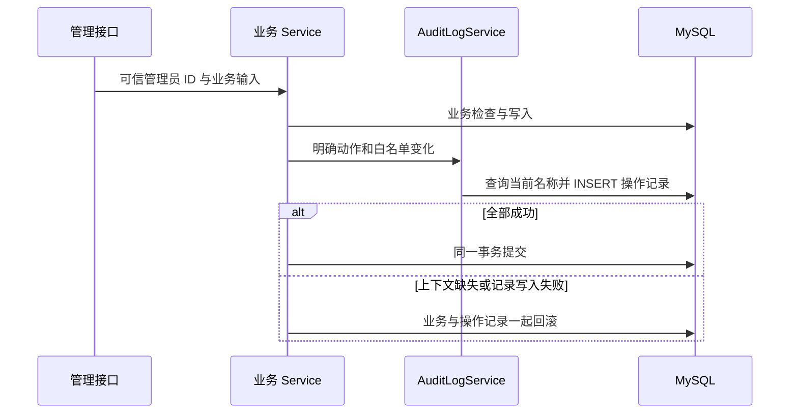

# 管理员操作记录：同事务保存业务历史

管理员可以在 `/admin/audit-logs` 查看发布、编辑、取消活动和首次签到的记录，并打开详情核对字段前后值。它记录已成功提交的业务变化，补充请求编号和运行日志；不记录每次访问或失败尝试，也不是外部合规审计平台。网站继续仅本地演示，实际执行结果统一见 [验证记录](verification.md)。

## 哪些操作产生记录

| 动作 | 产生时机 | `changes` 中的字段 |
| --- | --- | --- |
| `CREATE` | 每次成功创建一场新活动 | `title`、`description`、`location`、`startsAt`、`capacity`；变更前均为 `null` |
| `EDIT` | 允许编辑的三个字段经业务去除两端空白后，至少一个真实变化 | 只保存实际变化的 `title`、`description`、`location`，保留完整前后值 |
| `CANCEL` | 首次成功取消整场活动 | `cancelledAt`、`cancellationReason`；变更前均为 `null` |
| `CHECK_IN` | 首次成功为有效报名者签到 | `checkedInAt`；变更前为 `null`，关联报名 ID 与目标用户名称快照 |

无变化编辑不更新活动、不新增记录；有效的重复取消和重复签到返回首次结果，不新增记录。失败、无权限、开始边界不符、跨活动报名 ID 或非有效报名签到都不产生成功历史。普通用户报名、退出候补、递补、通知标读与 CSV 读取不在这四类中。

创建接口没有请求去重键：再次成功提交并创建了另一场活动，就会为这场新活动新增一条 `CREATE`，不能把同内容的两次创建说成一次。V6 不回填旧活动、旧取消或旧签到，已有演示种子也没有虚构的发布历史。

## V6、名称与字段快照

[V6 迁移](../backend/src/main/resources/db/migration/V6__create_activity_audit_logs.sql) 增加 `activity_audit_logs`，当前业务数据为用户、活动、报名、通知和操作记录五张表。旧迁移保持原样。

每行保存动作、活动 ID 和操作时标题、可信管理员 ID 及其操作时账号/昵称、可空报名 ID 和目标账号/昵称、UTC `DATETIME(6)` 操作时间，以及非空变化数组 `changes_json`。操作人 ID 来自可信登录身份；名称通过业务事务中的数据库查询取得，使用当前数据库值，不复制可能过期的 Session 昵称，也不接受客户端指定操作人。后续改名或编辑活动不改旧快照；编辑事件的活动标题是这次编辑后的标题，原标题仍在字段变化中。

每个变化为 `{field,before,after}`，`before`、`after` 都是 `string|null`，名额也用字符串保存。只允许四类业务代码明确构造的字段，完整介绍、换行、引号和大小写变化按原值保存；未设置的 `null` 与空字符串有区别。详情以文字显示，不能把其中的 HTML 当页面执行。

数据库分别为活动、操作人、报名建立 `ON DELETE RESTRICT` 外键；它们是三条独立外键，**不是**报名 ID 与活动 ID 的复合外键。CHECK 限定四种动作、签到目标字段配对以及变化必须为非空 JSON 数组；签到归属由 `findRosterRegistration(activityId, registrationId)` 和审计上下文查询的活动条件共同验证，不能声称外键已保证跨表活动一致。

时间按 UTC 微秒保存和返回，界面转换为北京时间，并保留服务端的小数六位。发布时先把提交的开始时间截为微秒，再检查落库值仍严格晚于本次当前时刻；纳秒输入截断后不再是未来时返回 400，不写活动或记录。发布快照中的 `startsAt` 使用与数据库相同的微秒值。取消、签到事件和相应业务字段使用同一个时间。

## 为什么必须与业务一起提交

`ActivityService.create/edit/cancel` 与 `CheckInService.checkIn` 在原写事务内调用 `AuditLogService`；追加方法使用 `Propagation.MANDATORY`，缺少外层事务时拒绝执行，不启动独立审计事务。编辑、取消、签到继续先取得活动主键行锁，取消/签到只在首次真实变化后追加。

创建失败不会留下活动；编辑失败恢复原文；取消失败恢复活动、人数、报名及本次通知；签到失败恢复两个签到字段，候补与通知保持原有行为。不能吞掉记录失败后向用户返回业务成功。读取历史不加业务活动锁。

## 两个只读管理接口

| 接口 | 合同 |
| --- | --- |
| `GET /api/admin/audit-logs` | `page=1&pageSize=10&action=ALL`，可选正整数 `activityId`；动作接受 `ALL|CREATE|EDIT|CANCEL|CHECK_IN`，每页 1–100 条；返回 `{items,total,page,pageSize}` |
| `GET /api/admin/audit-logs/{id}` | 返回同一条元数据和完整 `changes`；不存在返回 404 `AUDIT_LOG_NOT_FOUND` |

匿名调用返回 401，普通用户返回 403；服务端沿用 `/api/admin/**` 的 ADMIN 校验。列表按 `occurred_at DESC, id DESC` 稳定排序，类型与活动 ID 共同过滤；总数和当前页在只读 `REPEATABLE_READ` 事务中共用快照。越界页返回真实总数和空列表，由前端修正。

列表 SQL 只读元数据，不加载或返回长 `changes_json`；详情才分别读取元数据和变化，同样共用只读快照。两个 GET 纳入固定日志与指标路径，ID 不变成无限指标标签；GET 不需要先取 CSRF，也不自动重试。没有新增修改、删除操作记录的 API，也不提供记录导出。

操作记录只保存明确业务字段，不保存密码、哈希、Cookie、Token、Session、完整请求体或客户端提交的额外身份字段。请求日志继续不记录查询参数、原始 URL 或变化正文；不把业务历史当请求日志批量打印。只读 API 不等于数据库不可被管理员修改，当前没有签名链或外部防篡改存储。

## 页面、URL 与迟到响应

管理员从侧栏或活动管理某行的“操作记录”进入。动作、活动 ID、页码和数量由 URL 表示；活动 ID 输入草稿单独保存，提交正整数后规范化。默认每页 10 条，可选 10、20、50，合法自定义 URL 数量也保留。改变筛选或数量回第一页，相同查询与手动刷新都会重新读取，越界页以 `replace` 修正；刷新与浏览器历史保留条件。

列表不随意加载所有详情，点击某行才打开只读抽屉。详情展示名称快照、报名归属与完整前后值；没有目标用户的动作显示“不适用”，`null` 显示“未设置”。时间明确显示北京时间到微秒，长文换行保留。筛选、翻页或刷新关闭旧详情；404、读取失败和重新加载都有反馈。

路由先检查管理员权限再挂载页面，普通用户不发管理读取。列表与详情各有请求作用域，复用 `AuthProvider` 认证代次、`readAccountResource`、请求中止和当前条件保护；切换详情、关闭抽屉、离页、换账号或同账号重新登录后，旧成功不能覆盖新内容，旧 401 不能退出新会话。没有轮询。

## 精确清理与历史实验边界

当前测试、浏览器、默认容器、Redis 和认证限流独立环境门禁核对 V1–V6、五张业务表及既有签到列。环境身份与唯一 SQL/API 探针一致后才写测试数据；不在演示库重置或批量删历史。

准确核对本轮活动和账号后，在同一清理事务按 **操作记录 → 通知 → 报名 → 活动 → 用户** 删除。删除合成账号前检查其作为 `actor_user_id` 的外部记录，也保留既有报名、签到人、通知和活动创建/取消人外部引用保护。额外检查操作记录的报名与活动绑定：记录属于外部活动却指向本轮报名，或本轮活动的记录指向其他活动报名，都在任何 DELETE 前拒绝。原有管理员为本轮活动留下记录是合法情况，只删除已核对活动的记录，管理员账号与其他历史保留。

当前报名测量在活动准备阶段产生每新活动一条 `CREATE`；测量报名不能新增其他管理员动作，脚本核对记录仍为初始发布快照，并精确清理。历史固定 V2 实验仍只核对 V1/V2 与原三表，不查询通知、签到字段或操作记录，也不新增其报告合同字段；不能把当前 V6 与历史结果混算。

## 阅读与验证路径

1. [AuditLogController](../backend/src/main/java/com/example/gather/api/AuditLogController.java) → [SecurityConfiguration](../backend/src/main/java/com/example/gather/security/SecurityConfiguration.java) → [AuditLogService](../backend/src/main/java/com/example/gather/service/AuditLogService.java) → [AuditLogMapper](../backend/src/main/java/com/example/gather/mapper/AuditLogMapper.java)：先读权限、输入、快照和列表/详情 SQL 分工。
2. [ActivityService](../backend/src/main/java/com/example/gather/service/ActivityService.java)、[CheckInService](../backend/src/main/java/com/example/gather/service/CheckInService.java) → `AuditLogService` → [V6](../backend/src/main/resources/db/migration/V6__create_activity_audit_logs.sql)：确认真实变化分支、MANDATORY、可信身份、名称查询和事务边界。
3. [AdminAuditLogsPage](../frontend/src/pages/AdminAuditLogsPage.tsx)、[auditLogQuery](../frontend/src/auditLogQuery.ts)、[useAdminRead](../frontend/src/pages/useAdminRead.ts)、[AdminAuditLogDetail](../frontend/src/pages/AdminAuditLogDetail.tsx)：跟踪 URL、按需详情、认证代次、作用域和取消。
4. [AuditLogIntegrationTest](../backend/src/test/java/com/example/gather/AuditLogIntegrationTest.java)：真实 MySQL 的四类快照、当前数据库昵称、长文/无变化、微秒未来边界、重复/并发、插入失败回滚、只读列表/详情、快照、外键和清理保护；[前端回归](../frontend/tests/audit-logs.test.mjs) 检查 URL、微秒、原文和迟到保护。
5. [真实浏览器用例](../e2e/audit-logs.spec.ts)、[精确清理](../scripts/e2e-cleanup.mjs)、[默认容器](../scripts/compose-smoke.mjs)、[双实例](../scripts/redis-session-check.mjs)、[性能合同回归](../scripts/performance-check.test.mjs)：核对真实行为、重启保留、权限与安全清理。用例和脚本存在不代表已经全部运行成功，实际结果统一引用 [验证记录](verification.md)。
