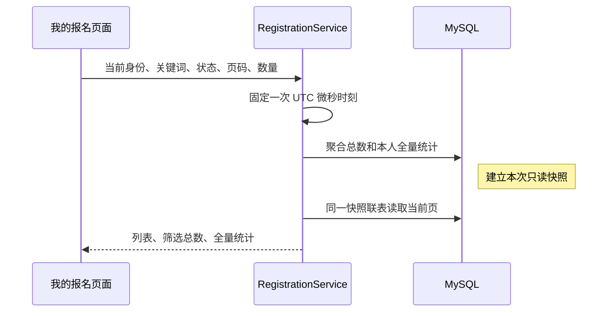

# 我的报名：本人签到、分页与联表读取

“我的报名”将有效报名、候补和取消历史放在同一个真实查询中，提供活动关键词搜索、状态筛选、分页、手动刷新及本人到场定位签到。管理员也可以参加活动，因此普通用户和管理员都只操作自己的报名；后台名单负责整场参与者与管理员确认、更正。

V15 在原签到时间之外新增方式与版本，关键词和候补查询不增加索引、依赖、轮询或缓存。报名、递补、取消和通知事务保持，网站继续在本机演示。

## 两个读取合同

| 接口 | 返回与兼容性 |
| --- | --- |
| `GET /api/me/registrations` | 保留原完整数组，每项仍为 `{id,status,activity}`；不添加签到时间或操作人字段，内部改为一次联表读取 |
| `GET /api/me/registrations/search` | 返回 `{items,total,page,pageSize,summary,locationCheckInEnabled}`，每项为 `{id,status,activity,checkedInAt,checkInMethod,checkInVersion}`，页面使用此接口 |
| `POST /api/me/registrations/{registrationId}/check-in` | 本人定位签到，必填WGS84经纬度、accuracyMeters、expectedVersion；返回本人记录，需CSRF |

新接口默认 `page=1&pageSize=10&status=ALL`，页码至少 1，每页 1–100 条，状态只接受 `ALL|ACTIVE|WAITING|CANCELLED`。这些参数省略时使用默认值，显式空值、非整数、越界数量或未知状态返回 400 `VALIDATION_ERROR`。匿名返回 401，客户端传入 `userId` 不能改变可信登录身份。

可选 `keyword` 默认空字符串，空值不限制活动；最多200个UTF-16代码单元，不裁剪首尾空格，按活动标题或地点的字面子串匹配。关键词使用绑定参数和 `LOCATE`，`%`、`_`、引号与反斜杠不会成为通配或SQL语法；超长返回400，不偷偷截断。关键词和报名状态按AND组合，仅影响 `items` 与 `total`，旧数组接口和省略关键词的请求保持兼容。

`id` 是报名记录 ID，`activity.id` 是所属活动 ID。两种接口均按报名 `updated_at DESC, id DESC` 稳定排序；活动内容包含真实人数、候补人数、本人 `registrationStatus`、开始状态与公开取消历史。活动开始状态使用每次请求唯一的 UTC 微秒时刻，接口时间为 UTC，页面按北京时间展示。

## 本人候补顺位

内嵌活动新增可空 `waitingPosition`，活动详情、公开旧数组/分页、管理活动及名单概况、收藏和本人报名的活动投影保持一致。仅可信Session本人当前为WAITING且活动未取消时返回从1开始的顺位；匿名、无报名、ACTIVE、CANCELLED或整场取消返回null，不接受客户端userId指定其他人。管理员参加活动时也只读取自己的顺位，不提供他人顺位名单。

顺位为1加上同活动WAITING中排在本人之前的人数，严格采用递补原规则 `updated_at ASC,id ASC`，相同微秒用报名ID排序。取消候补后其他人重排；满员时取消后重报复用原记录并按新的更新时间排队，真实递补为ACTIVE后顺位清空。报名截止后已有候补仍可在开始前取消或递补，因此继续显示顺位；活动开始后拒绝队列写入，保留候补历史顺位并明确“活动已开始，候补递补已停止”，不推算成功概率。

页面仅在本人WAITING且活动未取消时显示“候补第 N 位，前面还有 N−1 人”。接口缺字段、null或非正安全整数显示“候补顺位暂不可用”，不从候补总数或当前页推算。现有边界计时器更新开始/截止提示；服务端closed优先于落后的浏览器时钟。详情提供“刷新活动信息”，我的报名沿用“刷新报名”，均手动重读；不增加接口轮询。报名/取消在途时详情禁用刷新，点击回调另核提交所有权，防止刷新版本覆盖成功响应。

`WaitingQueueSql`在原ActivityMapper/RegistrationMapper SELECT内复用本人队列计数投影；收藏与管理活动沿共享活动列读取，个人旧数组仍一次、新分页仍聚合加联表两次业务SELECT，不为每行追加Mapper请求。排名与候补人数来自同条SELECT/同一事务快照；两次分页读取之间真实队列变化只在下次查询体现。数据库内部子查询工作随数据变化，不由固定请求次数推断恒定成本。V15的签到方式/版本直接复用本次联表，配置状态只为布尔，不改变读取次数、热锁投影、人数或通知。

新接口的筛选只影响 `items` 和 `total`，`summary` 始终覆盖本人全部历史：

| 字段 | 口径 |
| --- | --- |
| `activeRegistrations` | 全部 `ACTIVE` 记录 |
| `waitingRegistrations` | 全部 `WAITING` 记录，不占有效名额 |
| `cancelledRegistrations` | 全部 `CANCELLED` 历史，包含整场活动取消后的记录 |
| `checkedInRegistrations` | `ACTIVE` 中签到时间非空的记录，是有效报名的子集 |

本人返回可空 `checkedInAt`、`checkInMethod`（`ADMIN|SELF_LOCATION|null`）和 `checkInVersion`，不返回管理员ID、昵称或更正原因。`ACTIVE` 显示当前签到结果、方式及北京时间；候补和已取消显示“不适用”。四项统计只认当前ACTIVE及非空签到时间，撤销后统计随下次读取更新。越界页返回请求页码、真实总数与统计、空 `items`，不由服务端静默改页码。

`locationCheckInEnabled` 仅表示后端独立Web服务Key配置就绪，不保证提供商可用。活动未取消、本人ACTIVE未签、有GCJ-02坐标和结束时间且 `startsAt <= now < endsAt` 时可主动点击定位；原生WGS84点由服务器在活动事务外转换，精度须 `0 < accuracyMeters <= 100` 米，转换后距离须独立满足不超过300米。提交带当前版本，锁后再次核验；409版本冲突或未知提交结果先刷新核对。缺Key不调用转换、失败不签到，管理员仍可正常确认或纠错。完整接口、隐私、手机HTTPS限制见 [签到指南](checkin-export-guide.md#本人到场定位签到)。

## 快照与查询证据

`RegistrationService.searchMine` 使用只读 `REPEATABLE_READ`：一次聚合同时取得筛选总数和四项全量统计，再一次联表取得当前页的报名与活动。关键词总数与列表复用同一匹配SQL，聚合联表读取活动标题/地点，匹配条件只放在 `total` 的CASE中，不进入四项统计的WHERE；WHERE仍只限定本人。第一次一致性读取建立 InnoDB 快照；即使其他事务在两次读取之间提交取消或签到，本次列表与统计仍对应同一快照，后续刷新才能看到该提交。读取不添加活动行锁，不改变写操作的 `READ_COMMITTED` 设计。

旧服务原先先查报名，再逐条调用 `ActivityService.get`，N 条记录产生 1+N 次应用数据 SELECT；现在 `findMine` 一次联表，保留原数组字段与排序。新分页的 `mineTotals` 加 `searchMine` 固定为两次应用数据 SELECT。这里统计的是业务 Mapper 的数据读取，不包括认证读取或数据库内部子查询工作。

V7 后每个已登录 HTTP 请求另加一次仅取凭据版本的认证 SELECT：旧接口共一次认证加一次业务，新分页一次认证加两次业务。版本检查在业务事务快照之外；直接调用 Service 的查询证据仍是原业务次数，不包含 HTTP 认证。测试分别断言这两种范围，原因见 [改密指南](password-change-guide.md)。

V8 的活动分类通过 `MY_VIEW_COLUMNS → MyRegistrationRow.activity()` 同一联表直接读取，旧数组和新分页都在内嵌活动增加 `category`。个人页面保留原展示，不新增分类筛选，也不改变排序、统计、SELECT 次数或签到权限。分类业务合同见 [分类指南](activity-category-guide.md)。

2026-10-13 的真实 MySQL 8.4.11、专属 `activity_platform_test` 验证使用 13 场准确归属活动与 13 条本人记录，捕获结果为旧数组 1 次、新分页 2 次。对捕获的实际 SQL 执行 `EXPLAIN`：小表中的报名主表 `r` 选择 `ALL` 扫描，列表带 `Using filesort`；活动 `a` 以主键 `eq_ref` 关联；候补 `rw` 为 `DEPENDENT SUBQUERY`，使用 `uq_registration` 的活动前缀 `ref`。

这些是该测试数据上的计划和语句计数，不是生产容量证据。候补人数仍使用关联 COUNT，可能随外层行增加内部工作；排序与 OFFSET 也不是恒定成本。个人列表迭代未测接口延迟或吞吐，没有为小表扫描追加未经测量的索引。历史 V2 报名锁定查询对照继续按 [原实验合同](query-optimization-review.md) 复现，不将当时 V5 的读取变化混入其数字。

## URL、详情返回与认证保护

页面已提交条件来自 `/my-registrations` URL，按 `keyword,status,page,pageSize` 排序并省略默认值；默认 10 条，提供 10、20、50 条选项，合法 URL 自定义数量也保留。未知状态和非法数字规范为安全默认值，未知身份参数丢弃；超长URL关键词清空并提示，其他有效条件保留，不截断关键词。

搜索框有独立草稿，点击查询或回车后生效并回第一页，第一页同条件提交也重新查询。切换状态或数量只沿用已提交关键词并回第一页；手动刷新、错误重试也不提交草稿。重置和清除筛选清空关键词/状态，回第一页并保留数量。刷新、历史和详情/登录返回保留已提交条件；无匹配记录时提供清除筛选入口，四项统计仍覆盖本人全部历史。

从记录进入详情时，`from` 保存规范的个人列表地址，“返回我的报名”保留原筛选与页码；详情刷新或登录后仍保留来源。返回重新读取，取消造成末页越界时以 `replace` 回最后合法页，空集合回第一页，不形成历史或请求循环。公开来源继续显示原列表返回行为。

统一详情来源仅分派精确内部 `/activities` 或 `/my-registrations`，只解析对应已知条件并规范化；外部网址、双斜杠、管理路径、详情路径、点路径、原始反斜杠/控制字符和片段不接受。原 `safeActivityListPath` 保持只接受公开活动列表的合同，未扩成通用任意内部跳转。

个人页面复用 `AuthProvider.captureAccountRequest` 和 `readAccountResource`，成功和错误都核对认证代次及取消信号；页面作用域包含规范关键词/状态/分页、认证代次和刷新版本，刷新及导航事件立即使旧读取失效，排队越界修正也核对当前条件。`useResource` 继续管理请求顺序和中止。详情读取和报名/取消也核对认证代次、页面与提交信号；同账号重新登录仍产生新代次，旧成功不能覆盖新记录，旧 401 不能退出新会话。没有重复认证状态或 HTTP 客户端；统计加载/失败显示 `—`，不拿当前页推算或将失败伪装成 0。

## 阅读与验证路径

1. 从 `frontend/src/myRegistrationQuery.ts → pages/MyRegistrationsPage.tsx → api.ts` 跟踪 URL 与请求；从 `activityDetailNavigation.ts → pages/ActivityDetailPage.tsx` 跟踪安全来源、详情和登录返回。
2. 从 `ActivityController.searchMine → RegistrationService.searchMine → RegistrationMapper.mineTotals/searchMine → MyRegistrationRow/MyRegistrationModels` 跟踪可信身份、统计与两种 ID；再比较旧 `mine/findMine` 的数组兼容。
3. 从 `frontend/src/authRequestGuard.ts` 和 `tests/myregistrations.test.mjs` 查看真实迟到成功、同账号重登后的旧 401，以及已取消请求不能开始或发布结果的断言。
4. 从 `MyRegistrationSearchIntegrationTest` 查看真实 MySQL 的权限、旧字段、稳定分页、全量统计、UTC 时间、参数/越界、单次时钟、取消/签到夹在两次读取间、数据 SELECT 次数与实际执行计划；`MyRegistrationKeywordIntegrationTest` 补充关键词字面匹配、UTF-16长度、统计不过滤及并发编辑/取消快照，原业务并发与回滚测试继续保留。
5. 从 `e2e/myregistrations.spec.ts` 与 `e2e/myregistrations-keyword.spec.ts` 查看桌面/手机的真实记录、分页、状态/关键词、URL/登录/详情返回、本人签到、越界、失败重试与迟到身份回归；默认容器与共享 Redis 脚本另核对各实例本人数据和旧数组。测试自己的开始活动独立初始化，不改已有样例时间，按 manifest 精确清理。
6. 从 `pages/useLocationCheckIn.ts → nativeLocation.ts → LocationCheckInController → LocationCheckInService/LocationCheckInWriter` 查看主动定位、认证/路由/取消保护及事务边界；`GeoCheckInIntegrationTest` 的转换使用明确契约替身，不代表真实高德或真实手机GPS。

各轮后端、前端、浏览器、构建、容器和 Redis 环境的实际运行与失败修复统一以 [验证记录](verification.md) 为准，不以检查代码存在代替通过，也不以固定SELECT次数推断查询成本恒定或性能提升。
