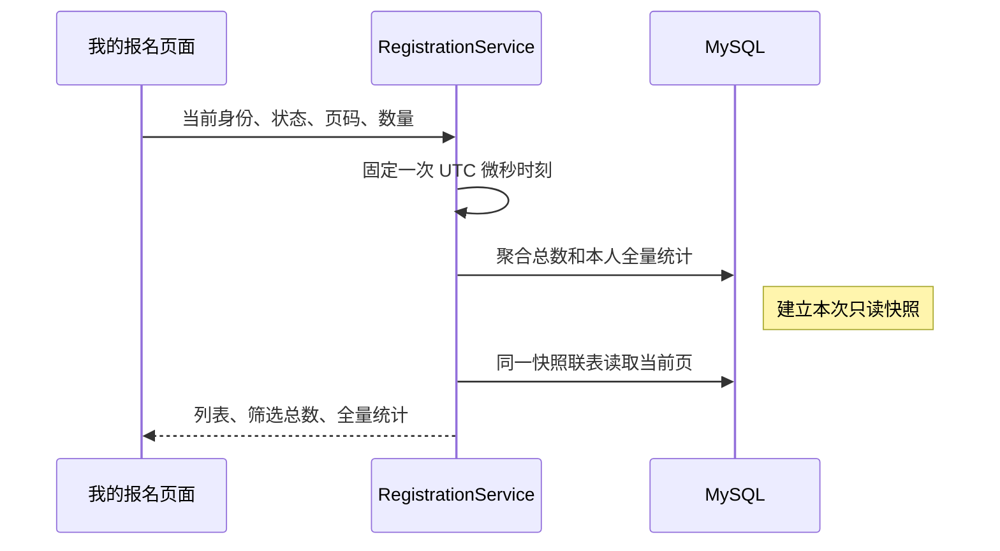

# 我的报名：本人签到、分页与联表读取

“我的报名”将有效报名、候补和取消历史放在同一个真实查询中，提供状态筛选、分页、手动刷新及本人签到结果。管理员也可以参加活动，因此普通用户和管理员都只查看自己的记录；后台报名名单仍负责管理整场参与者与签到写操作。

本轮复用 V5 的 `checked_in_at`，没有新增迁移、索引、依赖、轮询或缓存。报名、递补、取消、签到和通知写事务保持原有行为，网站继续在本机演示。

## 两个读取合同

| 接口 | 返回与兼容性 |
| --- | --- |
| `GET /api/me/registrations` | 保留原完整数组，每项仍为 `{id,status,activity}`；不添加签到时间或操作人字段，内部改为一次联表读取 |
| `GET /api/me/registrations/search` | 返回 `{items,total,page,pageSize,summary}`，每项为 `{id,status,activity,checkedInAt}`，页面使用此接口 |

新接口默认 `page=1&pageSize=10&status=ALL`，页码至少 1，每页 1–100 条，状态只接受 `ALL|ACTIVE|WAITING|CANCELLED`。省略参数使用默认值；显式空值、非整数、越界数量或未知状态返回 400 `VALIDATION_ERROR`。匿名返回 401，客户端传入 `userId` 不能改变可信登录身份。

`id` 是报名记录 ID，`activity.id` 是所属活动 ID。两种接口均按报名 `updated_at DESC, id DESC` 稳定排序；活动内容包含真实人数、候补人数、本人 `registrationStatus`、开始状态与公开取消历史。活动开始状态使用每次请求唯一的 UTC 微秒时刻，接口时间为 UTC，页面按北京时间展示。

新接口的筛选只影响 `items` 和 `total`，`summary` 始终覆盖本人全部历史：

| 字段 | 口径 |
| --- | --- |
| `activeRegistrations` | 全部 `ACTIVE` 记录 |
| `waitingRegistrations` | 全部 `WAITING` 记录，不占有效名额 |
| `cancelledRegistrations` | 全部 `CANCELLED` 历史，包含整场活动取消后的记录 |
| `checkedInRegistrations` | `ACTIVE` 中签到时间非空的记录，是有效报名的子集 |

签到信息只读，仅返回本人 `checkedInAt`，不返回管理员 ID 或昵称。`ACTIVE` 显示“已签到”及北京时间，或“未签到”；候补和已取消显示“不适用”。本人未签到不代表可由本人执行签到，签到仍须管理员在活动开始后确认。越界页返回请求页码、真实总数与统计、空 `items`，不由服务端静默改页码。

## 快照与查询证据

`RegistrationService.searchMine` 使用只读 `REPEATABLE_READ`：一次聚合同时取得筛选总数和四项全量统计，再一次联表取得当前页的报名与活动。第一次一致性读取建立 InnoDB 快照；即使其他事务在两次读取之间提交取消或签到，本次列表与统计仍对应同一快照，后续刷新才能看到该提交。读取不添加活动行锁，不改变写操作的 `READ_COMMITTED` 设计。

旧服务原先先查报名，再逐条调用 `ActivityService.get`，N 条记录产生 1+N 次应用数据 SELECT；现在 `findMine` 一次联表，保留原数组字段与排序。新分页的 `mineTotals` 加 `searchMine` 固定为两次应用数据 SELECT。这里统计的是业务 Mapper 的数据读取，不包括认证读取或数据库内部子查询工作。

V7 后每个已登录 HTTP 请求另加一次仅取凭据版本的认证 SELECT：旧接口共一次认证加一次业务，新分页一次认证加两次业务。版本检查在业务事务快照之外；直接调用 Service 的查询证据仍是原业务次数，不包含 HTTP 认证。测试分别断言这两种范围，原因见 [改密指南](password-change-guide.md)。

2026-10-13 的真实 MySQL 8.4.11、专属 `activity_platform_test` 验证使用 13 场准确归属活动与 13 条本人记录，捕获结果为旧数组 1 次、新分页 2 次。对捕获的实际 SQL 执行 `EXPLAIN`：小表中的报名主表 `r` 选择 `ALL` 扫描，列表带 `Using filesort`；活动 `a` 以主键 `eq_ref` 关联；候补 `rw` 为 `DEPENDENT SUBQUERY`，使用 `uq_registration` 的活动前缀 `ref`。

这些是该测试数据上的计划和语句计数，不是生产容量证据。候补人数仍使用关联 COUNT，可能随外层行增加内部工作；排序与 OFFSET 也不是恒定成本。个人列表迭代未测接口延迟或吞吐，没有为小表扫描追加未经测量的索引。历史 V2 报名锁定查询对照继续按 [原实验合同](query-optimization-review.md) 复现，不将当时 V5 的读取变化混入其数字。

## URL、详情返回与认证保护

页面已提交条件来自 `/my-registrations` URL，默认值省略；默认 10 条，提供 10、20、50 条选项，合法 URL 自定义数量也保留。未知状态和非法数字规范为安全默认值，未知身份参数丢弃。切换状态或数量回第一页；手动刷新确实请求数据库，刷新和浏览器前进后退保留条件。

从记录进入详情时，`from` 保存规范的个人列表地址，“返回我的报名”保留原筛选与页码；详情刷新或登录后仍保留来源。返回重新读取，取消造成末页越界时以 `replace` 回最后合法页，空集合回第一页，不形成历史或请求循环。公开来源继续显示原列表返回行为。

统一详情来源仅分派精确内部 `/activities` 或 `/my-registrations`，只解析对应已知条件并规范化；外部网址、双斜杠、管理路径、详情路径、点路径、原始反斜杠/控制字符和片段不接受。原 `safeActivityListPath` 保持只接受公开活动列表的合同，未扩成通用任意内部跳转。

个人页面复用 `AuthProvider.captureAccountRequest` 和 `readAccountResource`，成功和错误都核对认证代次及取消信号；`useResource` 管理当前条件、刷新序号和请求中止。详情读取和报名/取消也核对认证代次、页面与提交信号；同账号重新登录仍产生新代次，旧成功不能覆盖新记录，旧 401 不能退出新会话。没有重复认证状态或 HTTP 客户端；统计加载/失败显示 `—`，不拿当前页推算或将失败伪装成 0。

## 阅读与验证路径

1. 从 `frontend/src/myRegistrationQuery.ts → pages/MyRegistrationsPage.tsx → api.ts` 跟踪 URL 与请求；从 `activityDetailNavigation.ts → pages/ActivityDetailPage.tsx` 跟踪安全来源、详情和登录返回。
2. 从 `ActivityController.searchMine → RegistrationService.searchMine → RegistrationMapper.mineTotals/searchMine → MyRegistrationRow/MyRegistrationModels` 跟踪可信身份、统计与两种 ID；再比较旧 `mine/findMine` 的数组兼容。
3. 从 `frontend/src/authRequestGuard.ts` 和 `tests/myregistrations.test.mjs` 查看真实迟到成功、同账号重登后的旧 401，以及已取消请求不能开始或发布结果的断言。
4. 从 `MyRegistrationSearchIntegrationTest` 查看真实 MySQL 的权限、旧字段、稳定分页、全量统计、UTC 时间、参数/越界、单次时钟、取消/签到夹在两次读取间、数据 SELECT 次数与实际执行计划；原业务并发与回滚测试继续保留。
5. 从 `e2e/myregistrations.spec.ts` 查看桌面/手机的真实记录、10/3 分页、筛选、URL/登录/详情返回、本人签到、越界、失败重试与迟到身份回归；默认容器与共享 Redis 脚本另核对各实例本人数据和旧数组。测试自己的开始活动独立初始化，不改已有样例时间，按 manifest 精确清理。

前端本轮 60 项回归和 TypeScript/生产构建已执行通过，保留已有构建体积提示。完整后端、浏览器、容器和 Redis 环境的实际运行与失败修复统一以 [验证记录](verification.md) 为准，不以检查代码存在代替通过。

面试时可以解释“为什么统计不跟筛选变”“为什么两个 SELECT 需要同一快照”“为什么报名 ID 不是活动 ID”“为什么同账号重登也要拒绝旧响应”，以及减少应用查询次数与真正性能测量的区别。
