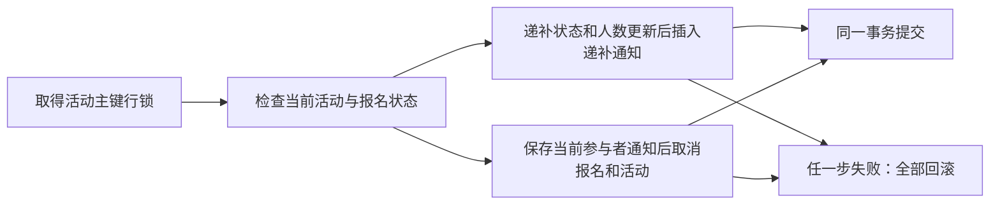

# 站内通知：递补、活动取消与已读状态

`/notifications` 为已登录用户提供站内消息，顶栏铃铛显示本人未读数量。通知只来自两类真实业务变化：候补者被递补为有效报名者，以及管理员取消活动。数据保存到 MySQL；默认内存 Session 和可选 Redis Session 都读取同一套通知记录。

## 通知产生的条件

| 类型 | 收件人 | 产生时机 |
| --- | --- | --- |
| `PROMOTED` | 本次从 `WAITING` 变成 `ACTIVE` 的用户 | 用户取消有效报名，系统按 FIFO 递补后 |
| `ACTIVITY_CANCELLED` | 取消发生时该活动的全部 `ACTIVE`、`WAITING` 用户 | 管理员首次成功取消活动时 |

首次报名、加入候补、取消候补和普通编辑不会生成通知。已经自行取消的用户不在整场取消的收件人集合中；管理员若自己是有效报名者或候补者，也会作为参与者收到通知。

消息保存发生时的活动标题。活动取消通知同时保存当时的公开原因和取消时间；后续展示读取通知行本身，避免以前的递补消息因管理员修改标题而被改写。详情链接仍打开当前活动信息。

第一版没有补发迁移之前的历史事件。V4 新建通知表，从迁移后的真实状态变化开始记录；没有邮件、短信、WebSocket 推送或定时轮询。

## 事务、行锁和重复操作

业务仍由 `RegistrationService`、`ActivityService` 的 `READ_COMMITTED` 事务控制，所有同活动报名、用户取消、编辑和整场取消先锁活动主键行。通知写入使用 `NotificationService` 的 `Propagation.MANDATORY` 方法，只能参加已经存在的业务事务，不另开一个独立提交的事务。

用户取消有效报名时，代码先把自己的记录变成 `CANCELLED` 并减人数，再按 `updated_at ASC, id ASC` 找最早候补者。实际存在候补者时，将其改为 `ACTIVE`、加回人数，再插入一条递补通知。活动主键锁仍持有，标题从这条活动的当前行取得。`created_at` 由这次 SQL 的 `UTC_TIMESTAMP(6)` 生成。

管理员取消活动时，代码在持有同一行锁、确认尚未取消且未开始后，先把当前 `ACTIVE`/`WAITING` 集合插入取消通知，再把这些报名改为 `CANCELLED`、人数归零并保存活动取消元数据。插入必须早于报名状态批量取消，否则收件人条件会变成空集合。通知的 `created_at` 与活动的 `cancelled_at` 使用同一个服务端 UTC 微秒时间和同一个规范化原因。

通知插入失败会回滚原用户取消或整场取消；通知已经插入、后续业务 SQL 失败时，也会连同人数和状态一起回滚。用户不会看到数据库已保存但实际没有发生的业务消息。

重复取消有效报名，在取得锁后已是 `CANCELLED`，不会再次递补或生成通知。重复组织者取消，在取得锁后已存在取消时间，返回首次结果，不再次插入。并发重复请求也按相同行锁串行判断。

这里不能给 `(user_id, activity_id, type)` 加永久唯一约束：同一用户被递补后，可以取消、重新进入候补，再次真正递补。第二次事件应产生新的通知 ID 和未读状态。幂等依据是真实状态转换与事务行锁，通知表不是每类消息只能存在一次。

## V4 数据模型

`V4__create_notifications.sql` 新增第四张业务表，不修改已经执行的 V1–V3：

- `user_id`、`activity_id` 是收件人与活动的外键，使用 `ON DELETE RESTRICT` 保留历史约束。
- `type` 只能是上述两类；快照标题不能为空。递补消息的取消原因必须为空，活动取消消息必须有合法原因。
- `created_at`、`read_at` 为 UTC `DATETIME(6)`；未读是 `read_at IS NULL`，已读时间不得早于创建时间。
- `(user_id, created_at DESC, id DESC)` 支持本人时间排序；另有包含 `read_at` 的索引，用于未读/已读读取。

通知不提供删除接口。打开通知页面、跳转详情不会自动标记已读；用户可逐条“标记已读”，或在确认覆盖范围后“全部标为已读”。

## 接口、权限与快照

| 方法与路径 | 响应 | 权限 |
| --- | --- | --- |
| `GET /api/me/notifications` | `{items,total,page,pageSize,unreadCount}` | 当前登录用户 |
| `GET /api/me/notifications/unread-count` | `{unreadCount}` | 当前登录用户 |
| `POST /api/me/notifications/{id}/read` | 标记后的单条通知 | 当前登录用户，需 CSRF |
| `POST /api/me/notifications/read-all` | `{updatedCount}`，本次实际新标读条数 | 当前登录用户，需 CSRF |

列表默认 `page=1`、`pageSize=10`、`status=ALL`、`type=ALL`。页码为正的 Java `int`，每页1–100条；status精确接受ALL、UNREAD、READ，type精确接受ALL、PROMOTED、ACTIVITY_CANCELLED，两者按AND组合。省略type保持旧列表合同，显式空值或未知值返回400 `VALIDATION_ERROR`，非法数字及分页同样拒绝。SQL使用绑定参数，COUNT与页内容共用类型和状态条件，不拼接客户端输入。

每条通知包含 `id`、`type`、`activityId`、`activityTitle`、`cancellationReason`、UTC `createdAt` 和可空的 UTC `readAt`。响应不提供收件人列表或其他用户资料。用户 ID 来自可信的 `AppUserDetails`；传入 `userId` 等字段不能选择其他收件人。

`total`是本人当前状态与类型共同筛选的匹配数；`unreadCount`始终是本人全部类型的未读数，不受筛选和分页影响。例如21条消息中15条未读，查看已读筛选时全局未读数仍为15。列表保持 `created_at DESC,id DESC` 排序，以ID消除时间相同时的顺序歧义。

`NotificationService.page` 在只读 `REPEATABLE_READ` 事务中读取未读数、筛选总数和当前页，三条 SQL 共用 InnoDB 一致性快照。并发标读或新通知提交时，本次响应不会混用新旧数据；下一次请求再读取新状态。超过末页时接口返回空 `items`，保留真实总数与请求页码，由页面修正到最后一个合法页，最少为第一页。

标读使用 `READ_COMMITTED` 事务。SQL 条件同时限定通知 ID、当前用户 ID 和 `read_at IS NULL`，第一次成功写入 `GREATEST(created_at, 服务端当前 UTC 微秒时间)`；随后查询本人通知返回结果。重复请求或并发标读保留第一次时间，不把每次点击变成新的已读时间。他人的 ID 与不存在的 ID 均返回 404 `NOTIFICATION_NOT_FOUND`，不泄露归属；匿名读取返回 401。

### 全部已读的处理边界

全部已读没有请求体或筛选参数，身份仅取Session，覆盖本人所有类型及分页。每次请求在READ_COMMITTED事务内先用一条普通SELECT，按ID升序捕获当时可见的本人未读ID集合；随后仅更新这些ID且仍未读的本人记录。捕获后新增的记录，以及捕获时尚未提交、之后才提交的较低ID记录，均保持未读；不使用最大ID或创建时间推测成员，不把“之后到达”误当作已查看。

非空集合用一次服务端UTC微秒时刻，按最多1000个ID分块更新，全部分块在同一事务。更新SQL固定使用PRIMARY索引并按ID升序扫描，避免不同捕获集合或创建时间顺序改变跨批锁顺序。更新继续使用GREATEST(created_at,now)及read_at IS NULL，保留单条或其他批量操作先写入的首次时间；空集合返回0且不发UPDATE。任何一批失败整体回滚，返回updatedCount只统计本次真实改动。再次手动操作重新选择当时未读集合；未知响应不自动重放，客户端先重读确认。该流程不改通知生成、报名事务、标题/原因快照或审计，也不新增数据库字段、索引、依赖或迁移，门禁保持V12。

CSRF 继续由既有 Spring Security 与 `api.ts` 处理：只有明确的 403 `CSRF_INVALID` 刷新 Token 并重试一次，401、普通权限拒绝、404 或未知失败不会按 CSRF 静默重放。日志与指标使用固定路由模板，不保存通知标题、原因或用户筛选参数。

## 页面与未读数量的归属

`NotificationProvider` 在既有 `AuthProvider` 下管理顶栏未读数与通知请求协调，不复制登录身份，也不增加另一个 HTTP 客户端。

- 登录身份就绪后，在非通知页面读取一次未读数；进入通知中心后，列表响应直接更新铃铛，不额外读取 `unread-count`。
- 切换状态/类型、翻页、点击“刷新通知”或成功标读后重新读取列表；离开通知中心时读取一次未读数。批量成功也读取真实列表与全局数量，不直接把铃铛清零；其他窗口产生消息后仍通过重新打开或手动刷新更新，没有轮询。
- 读取中与失败时显示 `—`；只有服务端实际返回 0 才表示没有未读消息。
- 状态、类型及分页保存在URL，默认值省略；类型选项为全部类型、候补递补、活动取消。刷新、历史导航、未登录直达后登录返回保留条件，改变状态/类型/每页数量回第一页，非法URL类型归ALL。没有使用当前页未读行数推算总数，未读页减少后的越界以replace修正，至少第一页。

“全部标为已读”确认框明确覆盖所有类型和分页；即便当前筛选为空，只要本人全局未读数已知且大于0仍可操作。加载、错误、数量未知/零或其他标读在途时禁用；确认期间防重复提交。成功关闭确认框并按当前条件重读；失败保留可见错误、重新读取真实状态，不能声称未知响应已回滚。

列表读取、单条/批量返回和迟到错误都检查请求所属账号与认证代次。即使同账号重登，旧响应也失效，旧401不能退出新会话。页面范围包含路径、状态、类型、分页和刷新版本；渲染阶段即隔离旧确认框、错误和busy，成功、错误、finally、未读统计及排队页码修正均核当前范围。离页或条件改变取消旧请求，旧操作不显示成功、清除新pending或触发旧导航。

`NotificationRequestOrder` 只管理统计读取顺序：新列表结果会让更早的铃铛请求失效；标读开始和完成都使旧统计读取失效，避免写之前或写期间取得的未读数重新覆盖最新值。页面读取通过 `useResource` 中止旧请求；React Strict Mode 清理也使用同一取消路径，没有重复事件监听和定时任务。

页面按北京时间显示创建及首次已读时间，提供加载、空集合、读取失败重试与登录失效反馈。桌面使用侧栏、手机抽屉进入通知中心，每条消息可打开当前活动详情并查看取消原因。

## 验证与代码阅读

推荐沿一个真实事件阅读：

1. `RegistrationService.cancel` 或 `ActivityService.cancel`：活动主键锁、状态判断、事务以及通知插入时机。
2. `NotificationService.promoted/activityCancelled → NotificationMapper → V4`：事务必须存在、SQL 收件人选择、快照与数据库约束。
3. `NotificationController → NotificationService.page/markRead/markAllRead`：可信身份、组合筛选、只读快照、精确ID集合与首次已读时间。
4. `frontend/src/api.ts → notifications.tsx → notificationRequests.ts → notificationRequestOrder.ts`：统一CSRF、认证代次与读写请求顺序。
5. `NotificationsPage.tsx → useNotificationActions.ts → notificationQuery.ts → Layout.tsx`：URL、翻页修正、确认与操作生命周期、北京时间及顶栏入口。

`NotificationIntegrationTest` 使用真实 MySQL，包含本人权限和 CSRF、筛选分页和统计快照、并发首次标读、数据库约束、重复/再次递补、取消的准确收件人和标题快照、两种行锁先后顺序，以及通知插入前后失败导致的业务回滚。它也检查日志使用固定通知路由、不泄露参数与快照内容。

前端 `notifications.test.mjs` 验证URL、类型编解码、读取顺序、读写交错及认证代次，`api.test.mjs` 验证通知请求不带客户端身份、信号、CSRF和错误重试边界。`e2e/notifications.spec.ts` 使用真实业务事件验证桌面/手机页面；`e2e/notification-bulk.spec.ts` 覆盖组合筛选、全局标读、新通知保留未读、确认/错误恢复、URL与迟到响应隔离。默认Compose冒烟和Redis双实例脚本核对通知的持久化、归属和跨实例标读。清理只删除本次准确归属活动的通知，发现临时账号引用外部活动的通知则拒绝整次清理。

代码中的断言与已执行通过是两个事实。各环境最终执行结果和数量统一见 [验证记录](verification.md)；运行命令与安全清理见 [交付指南](delivery-guide.md)，两实例数据与身份流向见 [共享 Session 指南](shared-session.md)。

## 业务演示与取舍

新建名额为 1 的未来活动，用户 A 报名、用户 B 加入候补。A 取消后，B 打开通知中心看到一条递补消息，标读后未读数减少；再由管理员取消活动，B 收到一条带公开原因的取消消息，已经自行取消的 A 没有该取消消息。对照数据库说明人数、状态和通知一起提交，以及重复操作为什么不会多发。

可以用“B 取消后重新候补，再次真正递补”的例子回答为什么通知不能永久按用户、活动和类型去重；用并发标读解释首次时间保留；用标题修改解释事件快照与当前活动详情的区别。真实 MySQL 回滚用例证明失败不会留下半完成事件，具体通过证据引用验证记录。

站内通知可以和业务写入同一个 MySQL 事务，因此当前方案没有引入消息队列。未来若增加邮件或短信，外部发送不能跟数据库一起自动回滚，需要另行设计可靠投递与重试；这不是当前已经实现的能力。同步取消通知的写入成本与大规模分页成本仍需实际测量，不将历史报名 SQL 实验数字用于证明新增通知的性能。
