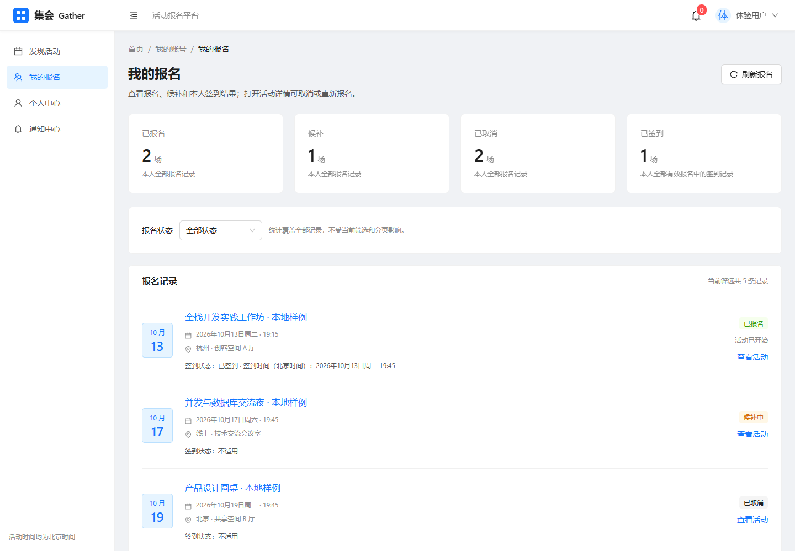
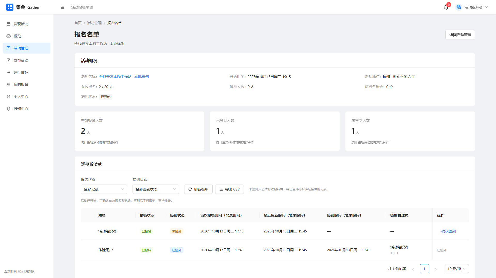

# 集会 Gather：真实界面展示

本页用于浏览作品界面。动态演示按 [五分钟演示指南](demo-guide.md) 进行；快速讲解和简历素材见 [面试展示包](interview-kit.md)，启动方式见 [README](../README.md)。

## 活动发现 · 桌面

用户通过标题或地点搜索、状态筛选和分页发现活动。上方统计来自服务端整个匹配集合，活动卡片显示真实人数、候补和开始状态。

阅读路径：[活动发现指南](activity-discovery.md) → [ActivitiesPage](../frontend/src/pages/ActivitiesPage.tsx) → [ActivityService](../backend/src/main/java/com/example/gather/service/ActivityService.java)。

## 我的报名 · 桌面

页面提供状态筛选、分页与手动刷新，四项统计覆盖当前用户全部报名记录。有效报名显示本人签到时间；候补和已取消记录显示签到不适用。详情返回保留查询条件。

阅读路径：[我的报名指南](my-registrations-guide.md) → [MyRegistrationsPage](../frontend/src/pages/MyRegistrationsPage.tsx) → [RegistrationService](../backend/src/main/java/com/example/gather/service/RegistrationService.java)。

## 管理员签到名单 · 桌面

管理员可以按报名与签到状态共同筛选，查看整场有效报名、已签到及未签到人数。活动开始后确认有效报名者到场，保存首次签到时间和操作人；CSV 导出覆盖整个匹配集合。名单列较多，表格支持横向滚动查看，右侧操作列固定；截图向右滚动展示完整签到管理员，用户名列位于左侧可滚动区域。

阅读路径：[签到与 CSV 指南](checkin-export-guide.md) → [AdminRegistrationsPage](../frontend/src/pages/AdminRegistrationsPage.tsx) → [CheckInService](../backend/src/main/java/com/example/gather/service/CheckInService.java)。

## 我的报名 · 手机

手机通过抽屉导航访问页面，保留个人统计、筛选、活动详情入口和本人签到展示。以下使用 390×844 的手机视口布局，截取 390×1004 的页面上段，便于同时查看统计和首条完整签到记录。

## 截图来源与复现

- 采集日期：2026-10-13（北京时间）。界面与接口对应源码 `52fb7495ef06889ed8912061a8dab6a1fdf9cd63`，此前文档基线为 `17c1a4f`。
- 本地环境：`127.0.0.1:5173` 的 Vite 前端、`127.0.0.1:8080` 的 Spring Boot 服务、MySQL 8.4.11；默认内存 Session。使用 Playwright 驱动真实 Chrome 154。
- 图片尺寸：桌面活动发现与个人报名均为 1440×1000，管理员名单为 1920×1080，手机页面上段为 390×1004。
- 图片来自实际页面、Java 接口和 MySQL 数据，没有替换接口响应。样例仅用于展示，截图中的日期、ID、人数和状态属于采集时刻。
- 已开始的签到活动使用本轮独立归属的初始化数据；既有活动开始时间和预置账号资料保持原值。签到通过真实管理员页面确认。
- 捕获后按精确归属清理本轮样例，原有四张业务表的行摘要保持一致。截图中的临时样例不会作为长期演示数据保留。重新启动只会显示当时数据库中的记录；按演示指南准备自己的新活动即可体验未来活动的报名和候补，签到需等待活动自然开始。

本页展示的是界面与业务结果。事务、权限、并发和浏览器回归的具体证据见 [验证记录](verification.md)，截图本身不证明容量、性能或个人掌握程度。网站继续仅供本地演示。
